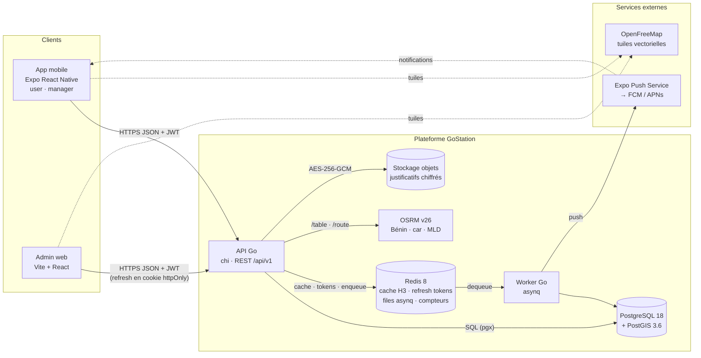
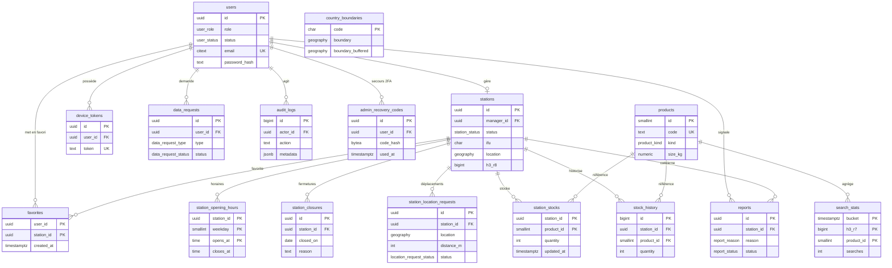
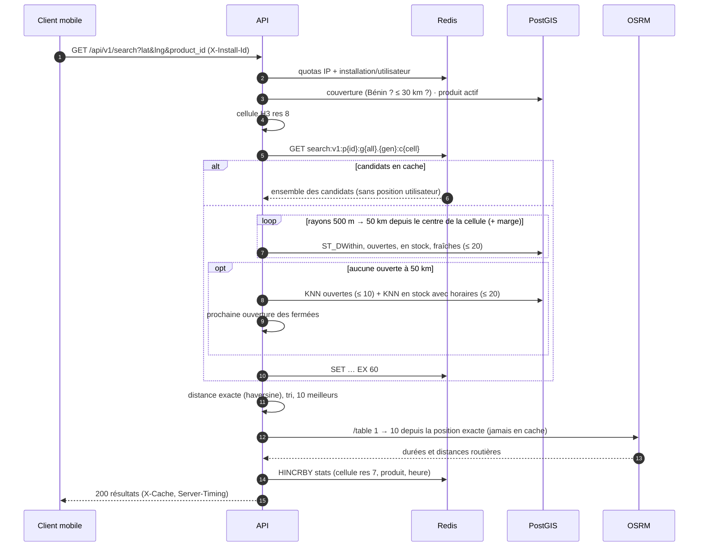
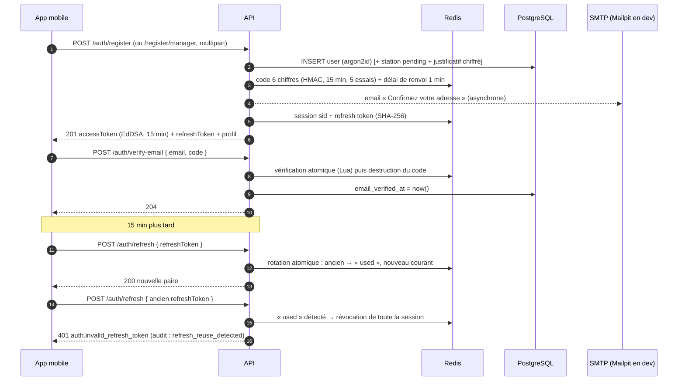
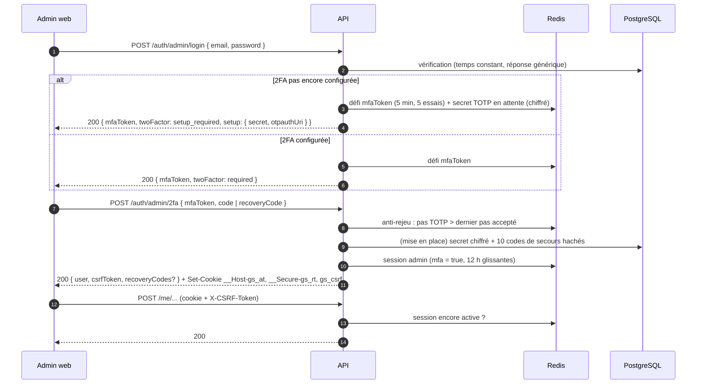

# GoStation — Architecture

> Document prévisionnel (étape 0 : fondations). Il fixe les choix structurants avant le code ; il évoluera avec les migrations goose et les specs d'API.
> Conventions et règles transverses : [`CLAUDE.md`](../CLAUDE.md).

**Sommaire** : 1. Vue d'ensemble · 2. Composants · 3. Modèle de données · 4. Algorithme de recherche · 5. Endpoints API · 6. Authentification et sécurité · 7. Jobs asynchrones · 8. Données personnelles et conservation · 9. Questions ouvertes

---

## 1. Vue d'ensemble



Principes :
- **Un seul binaire Go, deux points d'entrée** (`cmd/api`, `cmd/worker`) qui partagent `internal/`. L'API est sans état : on la scale horizontalement.
- **OSRM n'est jamais exposé publiquement** : l'API le proxifie (`/routes`), ce qui permet le rate limiting et garantit qu'aucune position n'est journalisée.
- **Les tuiles OpenFreeMap sont chargées directement par les clients** (pas de proxy).
- **Le stockage des justificatifs** est un système de fichiers local en dev et un stockage objet compatible S3 en prod (§9, Q5).

## 2. Composants

| Composant | Rôle | Techno |
|---|---|---|
| API | Auth, recherche, gestion des stations et des stocks, back-office admin | Go, chi, pgx v5 + sqlc, go-redis v9, golang-jwt v5, h3-go v4, slog |
| Worker | Rappels de stock, envoi des push, agrégation des stats, purges de conservation, exports de données | asynq (Redis) |
| PostgreSQL + PostGIS | Source de vérité ; requêtes spatiales (`ST_DWithin`, KNN `<->`) | PG 18, PostGIS 3.6, migrations goose |
| Redis | Cache de recherche (H3 + produit), refresh tokens, files asynq, rate limiting, compteurs de stats | Redis 8.10, `noeviction` |
| OSRM | Matrice de temps de trajet (`/table`) et itinéraire (`/route`) | osrm-backend v26.10, MLD |
| Mobile | Recherche, carte, itinéraire (user) ; station, horaires, stocks (manager) | Expo SDK 57, MapLibre RN, TanStack Query, Zustand |
| Web admin | Validation, catalogue, carte, pénuries, signalements, stats, audit, demandes APDP | Vite, React 19, Tailwind 4, shadcn/ui, 21st.dev, TanStack Router/Query, maplibre-gl |

## 3. Modèle de données

Conventions : PK `uuid DEFAULT uuidv7()` (natif PG 18, triable dans le temps), `timestamptz` en UTC, enums PostgreSQL, contraintes nommées. Extensions : `postgis`, `citext`.



### 3.1 Types énumérés

```sql
CREATE TYPE user_role           AS ENUM ('user', 'manager', 'admin');
CREATE TYPE user_status         AS ENUM ('active', 'disabled', 'pending_deletion');
CREATE TYPE station_status      AS ENUM ('pending', 'approved', 'rejected', 'suspended');
CREATE TYPE product_kind        AS ENUM ('lpg', 'petrol', 'diesel');   -- gaz domestique, essence, gasoil
CREATE TYPE product_unit        AS ENUM ('cylinder', 'liter');
CREATE TYPE stock_source        AS ENUM ('manager', 'admin', 'system');
CREATE TYPE report_reason       AS ENUM ('stock_incorrect', 'station_closed', 'wrong_location', 'other');
CREATE TYPE report_status       AS ENUM ('open', 'resolved', 'dismissed');
CREATE TYPE data_request_type   AS ENUM ('access', 'export', 'rectification', 'deletion', 'opposition');
CREATE TYPE data_request_status AS ENUM ('pending', 'in_progress', 'completed', 'rejected');
CREATE TYPE device_platform     AS ENUM ('ios', 'android');
```

### 3.2 Tables

```sql
-- Comptes (les trois rôles). Aucune position, aucun téléphone personnel.
CREATE TABLE users (
  id                      uuid PRIMARY KEY DEFAULT uuidv7(),
  role                    user_role   NOT NULL DEFAULT 'user',
  status                  user_status NOT NULL DEFAULT 'active',
  email                   citext      NOT NULL,
  password_hash           text        NOT NULL,             -- argon2id, format PHC (params inclus)
  first_name              text        NOT NULL CHECK (char_length(first_name) BETWEEN 1 AND 100),
  last_name               text        NOT NULL CHECK (char_length(last_name)  BETWEEN 1 AND 100),
  email_verified_at       timestamptz,
  privacy_policy_version  text        NOT NULL,             -- version acceptée à l'inscription
  privacy_accepted_at     timestamptz NOT NULL,
  last_login_at           timestamptz,
  deletion_requested_at   timestamptz,                      -- purge définitive à +30 j (job)
  created_at              timestamptz NOT NULL DEFAULT now(),
  updated_at              timestamptz NOT NULL DEFAULT now(),
  CONSTRAINT uq_users_email UNIQUE (email)
);

-- Stations. V1 : un gérant = une station.
CREATE TABLE stations (
  id                    uuid PRIMARY KEY DEFAULT uuidv7(),
  manager_id            uuid REFERENCES users(id) ON DELETE SET NULL,
  status                station_status NOT NULL DEFAULT 'pending',
  name                  text NOT NULL,
  brand                 text,                                -- marque, normalisée par l'admin
  ifu                   char(13) NOT NULL CHECK (ifu ~ '^[0-9]{13}$'),
  rccm                  text NOT NULL,                       -- format validé côté API
  address               text NOT NULL,
  city                  text,
  phone                 text NOT NULL,                       -- E.164 (+229…)
  location              geography(Point, 4326),              -- NULL tant que non épinglée
  lat                   double precision GENERATED ALWAYS AS (ST_Y(location::geometry)) STORED,
  lng                   double precision GENERATED ALWAYS AS (ST_X(location::geometry)) STORED,
  location_set_at       timestamptz,
  h3_r8                 bigint,                              -- cellule H3 res 8 (h3-go), stats et pénuries
  document_object_key   text,                                -- justificatif chiffré (stockage objet)
  document_wrapped_key  bytea,                               -- DEK chiffrée par la KEK (enveloppe)
  document_sha256       bytea,
  document_mime         text CHECK (document_mime IN ('application/pdf', 'image/jpeg', 'image/png')),
  status_reason         text,                                -- motif de rejet ou de suspension
  reviewed_by           uuid REFERENCES users(id) ON DELETE SET NULL,
  reviewed_at           timestamptz,
  last_stock_update_at  timestamptz,                         -- dénormalisé : données périmées et rappels
  last_reminder_at      timestamptz,
  created_at            timestamptz NOT NULL DEFAULT now(),
  updated_at            timestamptz NOT NULL DEFAULT now(),
  CONSTRAINT uq_stations_manager UNIQUE (manager_id)
);
-- Index spatial partiel : ne couvre que ce que la recherche peut renvoyer.
CREATE INDEX idx_stations_location_approved ON stations USING gist (location)
  WHERE status = 'approved' AND location IS NOT NULL;
CREATE INDEX idx_stations_status  ON stations (status, created_at DESC);
CREATE INDEX idx_stations_ifu     ON stations (ifu);           -- non unique : un IFU peut couvrir un réseau (§9)
-- Données périmées (admin) et rappels : stations approuvées triées par fraîcheur.
CREATE INDEX idx_stations_last_stock_update ON stations (last_stock_update_at)
  WHERE status = 'approved';

-- Horaires (ISO 8601 : 1 = lundi). 24 h/24 : 00:00 → 24:00. closes_at < opens_at = passe minuit.
CREATE TABLE station_opening_hours (
  station_id  uuid     NOT NULL REFERENCES stations(id) ON DELETE CASCADE,
  weekday     smallint NOT NULL CHECK (weekday BETWEEN 1 AND 7),
  opens_at    time     NOT NULL,
  closes_at   time     NOT NULL,
  PRIMARY KEY (station_id, weekday, opens_at)
);

-- Catalogue configurable par l'admin (tailles de gaz). Jamais supprimé : désactivé.
CREATE TABLE products (
  id          smallint GENERATED ALWAYS AS IDENTITY PRIMARY KEY,
  code        text NOT NULL UNIQUE,                    -- 'lpg_6kg', 'lpg_12_5kg', 'petrol', 'diesel'
  kind        product_kind NOT NULL,
  unit        product_unit NOT NULL,
  size_kg     numeric(5,2),
  label_fr    text NOT NULL,                           -- « Gaz 12,5 kg »
  is_active   boolean  NOT NULL DEFAULT true,
  sort_order  smallint NOT NULL DEFAULT 0,
  created_at  timestamptz NOT NULL DEFAULT now(),
  updated_at  timestamptz NOT NULL DEFAULT now(),
  CONSTRAINT ck_products_kind_unit CHECK (
    (kind = 'lpg' AND unit = 'cylinder' AND size_kg IS NOT NULL AND size_kg > 0)
    OR (kind IN ('petrol', 'diesel') AND unit = 'liter' AND size_kg IS NULL)),
  CONSTRAINT uq_products_kind_size UNIQUE NULLS NOT DISTINCT (kind, size_kg)
);

-- Stock courant : bouteilles (gaz) ou litres (carburants).
CREATE TABLE station_stocks (
  station_id  uuid     NOT NULL REFERENCES stations(id) ON DELETE CASCADE,
  product_id  smallint NOT NULL REFERENCES products(id),
  quantity    integer  NOT NULL CHECK (quantity >= 0),
  updated_by  uuid REFERENCES users(id) ON DELETE SET NULL,
  updated_at  timestamptz NOT NULL DEFAULT now(),       -- « mis à jour il y a X min »
  PRIMARY KEY (station_id, product_id)
);
CREATE INDEX idx_station_stocks_available ON station_stocks (product_id, station_id)
  WHERE quantity > 0;
CREATE INDEX idx_station_stocks_updated_at ON station_stocks (updated_at);  -- stale (> 8 h) / expiré (> 24 h)

-- Historique des stocks : écrit dans la même transaction que station_stocks (pas de trigger).
CREATE TABLE stock_history (
  id                 bigint GENERATED ALWAYS AS IDENTITY PRIMARY KEY,
  station_id         uuid     NOT NULL REFERENCES stations(id) ON DELETE CASCADE,
  product_id         smallint NOT NULL REFERENCES products(id),
  quantity           integer  NOT NULL,
  previous_quantity  integer,
  source             stock_source NOT NULL,
  changed_by         uuid REFERENCES users(id) ON DELETE SET NULL,
  created_at         timestamptz NOT NULL DEFAULT now()
);
CREATE INDEX idx_stock_history_station ON stock_history (station_id, product_id, created_at DESC);
-- Partitionnement mensuel (RANGE created_at) quand on dépasse ~10 M lignes.

-- Tokens push Expo. Supprimés à la déconnexion, quand Expo renvoie DeviceNotRegistered, ou après 90 j sans activité.
CREATE TABLE device_tokens (
  id            uuid PRIMARY KEY DEFAULT uuidv7(),
  user_id       uuid NOT NULL REFERENCES users(id) ON DELETE CASCADE,
  token         text NOT NULL UNIQUE,                  -- ExponentPushToken[…]
  platform      device_platform NOT NULL,
  app_version   text,
  last_seen_at  timestamptz NOT NULL DEFAULT now(),
  created_at    timestamptz NOT NULL DEFAULT now()
);
CREATE INDEX idx_device_tokens_user ON device_tokens (user_id);

-- Signalements des utilisateurs.
CREATE TABLE reports (
  id               uuid PRIMARY KEY DEFAULT uuidv7(),
  station_id       uuid NOT NULL REFERENCES stations(id) ON DELETE CASCADE,
  product_id       smallint REFERENCES products(id),
  reporter_id      uuid REFERENCES users(id) ON DELETE SET NULL,
  reason           report_reason NOT NULL,
  comment          text CHECK (char_length(comment) <= 500),
  status           report_status NOT NULL DEFAULT 'open',
  resolved_by      uuid REFERENCES users(id) ON DELETE SET NULL,
  resolution_note  text,
  resolved_at      timestamptz,
  created_at       timestamptz NOT NULL DEFAULT now()
);
CREATE INDEX idx_reports_open    ON reports (created_at DESC) WHERE status = 'open';
CREATE INDEX idx_reports_station ON reports (station_id, created_at DESC);

-- Journal d'audit, en ajout seul : le rôle applicatif n'a que INSERT et SELECT. La purge passe par un rôle dédié.
CREATE TABLE audit_logs (
  id           bigint GENERATED ALWAYS AS IDENTITY PRIMARY KEY,
  actor_id     uuid REFERENCES users(id) ON DELETE SET NULL,
  actor_role   user_role,
  action       text NOT NULL,             -- 'station.approve', 'document.view', 'product.update', 'user.purge'…
  entity_type  text NOT NULL,
  entity_id    text,
  metadata     jsonb NOT NULL DEFAULT '{}', -- avant/après, sans donnée personnelle superflue
  request_id   text,
  created_at   timestamptz NOT NULL DEFAULT now()
);
CREATE INDEX idx_audit_logs_entity ON audit_logs (entity_type, entity_id, created_at DESC);
CREATE INDEX idx_audit_logs_actor  ON audit_logs (actor_id, created_at DESC);

-- Demandes d'exercice des droits (APDP / RGPD).
CREATE TABLE data_requests (
  id                 uuid PRIMARY KEY DEFAULT uuidv7(),
  user_id            uuid REFERENCES users(id) ON DELETE SET NULL,
  type               data_request_type   NOT NULL,
  status             data_request_status NOT NULL DEFAULT 'pending',
  details            text,
  due_at             timestamptz NOT NULL,           -- échéance légale (délai à confirmer, §9)
  handled_by         uuid REFERENCES users(id) ON DELETE SET NULL,
  response_note      text,
  export_object_key  text,                           -- archive chiffrée, lien expirant
  created_at         timestamptz NOT NULL DEFAULT now(),
  completed_at       timestamptz
);
CREATE INDEX idx_data_requests_status ON data_requests (status, due_at);

-- Ajout : stats de recherche anonymes, la seule trace des recherches.
-- Les compteurs vivent dans Redis (HINCRBY) et sont vidés ici toutes les 5 min par le worker.
CREATE TABLE search_stats (
  bucket          timestamptz NOT NULL,             -- heure tronquée
  h3_r7           bigint      NOT NULL,             -- cellule ≈ 5 km², jamais la position
  product_id      smallint    NOT NULL REFERENCES products(id),
  searches        integer     NOT NULL DEFAULT 0,
  empty_within_5km integer    NOT NULL DEFAULT 0,   -- aucun stock à ≤ 5 km : signal de pénurie
  PRIMARY KEY (bucket, h3_r7, product_id)
);

-- Auth (étape 3) : 2FA TOTP des admins et date de changement du mot de passe.
ALTER TABLE users
  ADD COLUMN password_changed_at    timestamptz,
  ADD COLUMN totp_secret_encrypted  bytea,        -- AES-256-GCM (clé dérivée d'APP_SECRET), lié à l'id
  ADD COLUMN totp_enabled_at        timestamptz,
  ADD CONSTRAINT ck_users_totp CHECK ((totp_secret_encrypted IS NULL) = (totp_enabled_at IS NULL));

-- 10 codes de secours par admin : SHA-256 de codes à 80 bits d'entropie, usage unique.
CREATE TABLE admin_recovery_codes (
  id          uuid PRIMARY KEY DEFAULT uuidv7(),
  user_id     uuid NOT NULL REFERENCES users(id) ON DELETE CASCADE,
  code_hash   bytea NOT NULL,
  used_at     timestamptz,
  created_at  timestamptz NOT NULL DEFAULT now(),
  CONSTRAINT uq_admin_recovery_codes_code UNIQUE (user_id, code_hash)
);

-- Stations et stocks côté gérant (étape 4).
ALTER TABLE stations
  ADD COLUMN version                   integer NOT NULL DEFAULT 1,  -- verrouillage optimiste (ETag)
  ADD COLUMN location_flagged_at       timestamptz,  -- épingle à plus de 500 m de l'appareil
  ADD COLUMN location_flag_distance_m  integer,
  ADD COLUMN location_flag_accuracy_m  integer;

-- updated_at ne bouge que si la quantité change (trigger dédié set_stock_updated_at) ;
-- last_confirmed_at enregistre « rien n'a changé ». Fraîcheur = GREATEST(updated_at, last_confirmed_at).
ALTER TABLE station_stocks ADD COLUMN last_confirmed_at timestamptz NOT NULL DEFAULT now();
CREATE INDEX idx_station_stocks_freshness ON station_stocks (GREATEST(updated_at, last_confirmed_at));
-- (remplace idx_station_stocks_updated_at)

-- Fermetures exceptionnelles (jours fériés compris) : journée civile entière, heure du Bénin.
CREATE TABLE station_closures (
  id          uuid PRIMARY KEY DEFAULT uuidv7(),
  station_id  uuid NOT NULL REFERENCES stations(id) ON DELETE CASCADE,
  closed_on   date NOT NULL,
  reason      text CHECK (char_length(reason) <= 200),
  created_by  uuid REFERENCES users(id) ON DELETE SET NULL,
  created_at  timestamptz NOT NULL DEFAULT now(),
  CONSTRAINT uq_station_closures_day UNIQUE (station_id, closed_on)
);

-- Demandes de déplacement (≥ 200 m) : l'ancienne position reste active jusqu'à validation.
CREATE TYPE location_request_status AS ENUM ('pending', 'approved', 'rejected', 'superseded');
CREATE TABLE station_location_requests (
  id                 uuid PRIMARY KEY DEFAULT uuidv7(),
  station_id         uuid NOT NULL REFERENCES stations(id) ON DELETE CASCADE,
  requested_by       uuid REFERENCES users(id) ON DELETE SET NULL,
  location           geography(Point, 4326) NOT NULL,  -- + lat/lng générées
  h3_r8              bigint NOT NULL,
  distance_m         integer NOT NULL,      -- depuis la position active
  device_distance_m  integer,               -- seule trace de la position de l'appareil
  device_accuracy_m  integer,
  status             location_request_status NOT NULL DEFAULT 'pending',
  review_reason      text,
  reviewed_by        uuid REFERENCES users(id) ON DELETE SET NULL,
  reviewed_at        timestamptz,
  created_at         timestamptz NOT NULL DEFAULT now()
);
CREATE UNIQUE INDEX uq_station_location_requests_pending ON station_location_requests (station_id)
  WHERE status = 'pending';   -- une nouvelle demande remplace la précédente (superseded)

-- Frontières (contrôle des épingles) : Natural Earth 1:10m, domaine public, migration de données.
CREATE TABLE country_boundaries (
  code               char(3) PRIMARY KEY,               -- 'BEN'
  name               text NOT NULL,
  boundary           geography(MultiPolygon, 4326) NOT NULL,
  boundary_buffered  geography NOT NULL,                -- ST_Buffer(boundary, 2000) : marge de 2 km
  source             text NOT NULL
);

-- Ajout (décision §9) : favoris, réservés aux utilisateurs connectés. Supprimés avec le compte.
CREATE TABLE favorites (
  user_id     uuid NOT NULL REFERENCES users(id) ON DELETE CASCADE,
  station_id  uuid NOT NULL REFERENCES stations(id) ON DELETE CASCADE,
  created_at  timestamptz NOT NULL DEFAULT now(),
  PRIMARY KEY (user_id, station_id)
);
CREATE INDEX idx_favorites_station ON favorites (station_id);
```

**Colonnes `lat` / `lng` générées** : l'application ne lit jamais le type `geography`. Elle écrit `location` à partir de `lat`/`lng` (`ST_MakePoint(lng, lat)`) et lit les colonnes générées, que sqlc type correctement en `*float64` nullables. Une expression `ST_Y(...)` dans un SELECT serait typée non nullable par sqlc. `STORED` est imposé : PostgreSQL 18 interdit les fonctions d'extension dans une colonne virtuelle.

**Trigger `updated_at`** : une fonction `set_updated_at()` est appelée `BEFORE UPDATE` sur `users`, `stations`, `products` et `station_stocks`. Elle pose `now()`, sauf si la requête fixe elle-même `updated_at` (reprises de données, tests de péremption).

**Catalogue initial** (migration de données séparée) : gaz 5 kg, 10 kg et 25 kg (unité : bouteille), essence et gasoil (unité : litre). Tout est modifiable par l'admin.

## 4. Algorithme de recherche

**Entrée** : `product_id`, `lat`, `lng` (position courante, jamais stockée ni journalisée). Endpoint **public**, connexion facultative. Quotas (D22) : 300/min par IP et 30/min par installation (`X-Install-Id`) ou par utilisateur connecté.
**Sortie** : jusqu'à 10 stations `approved`, avec horaires, produit vendu en `quantity > 0`, stock de moins de 24 h et **ouvertes maintenant**, classées par temps de trajet réel. S'il n'y a aucune station ouverte à 50 km : repli sur les ouvertes plus loin et les fermées, triées par heure à laquelle on peut être servi (D19).

**Fraîcheur du stock** (âge = `now() - GREATEST(updated_at, last_confirmed_at)` : une confirmation « rien n'a changé » compte comme une mise à jour) :

| Âge | Effet |
|---|---|
| ≤ 8 h (`STOCK_STALE_AFTER`) | Normal |
| 8 h à 24 h | `stale: true` : badge « à vérifier » côté UI |
| > 24 h (`STOCK_EXPIRED_AFTER`) | Exclu de la recherche, quantité masquée sur la fiche publique |

**Ouverture** : calculée à partir de `station_opening_hours` et `station_closures` dans le fuseau `APP_TIMEZONE` (`Africa/Porto-Novo`), par la même règle que `station.Schedule.IsOpen` (testée sur les cas limites). Les plages qui passent minuit (`closes_at <= opens_at`) et le 24 h/24 (`00:00 → 24:00`) sont gérés. Une fermeture exceptionnelle ferme la journée civile entière, y compris la fin, ce jour-là, d'une plage commencée la veille. Le jour ISO, l'heure locale, la date et la veille sont calculés en Go puis passés en paramètres SQL. Une station sans horaires ou sans position n'apparaît pas.



### 4.1 Étapes

1. **Validation et couverture (D20).** Coordonnées dans les bornes, produit actif. `CheckCoverage` : `ST_Covers(boundary_buffered, p)` → au Bénin (frontière élargie de 2 km), classement OSRM ; sinon `ST_DWithin(boundary, p, 30 km)` → classement à vol d'oiseau, `routingApproximate: true` ; sinon 422 `search.out_of_coverage`.
2. **Candidats, en cache par cellule.** `cell = H3(lat, lng, res 8)`. Clé `search:v1:p{productId}:g{all}.{gen}:c{cell}` (paquet `searchcache`), TTL `SEARCH_CACHE_TTL` (60 s). Le cache ne contient **que l'ensemble des stations candidates** (id, nom, marque, position de la station, quantité, fraîcheur, ouverte ou non, prochaine ouverture) et la stratégie : ni la position de l'utilisateur, ni un classement. Les candidats sont calculés depuis le **centre de la cellule** ; chaque rayon est augmenté du rayon circonscrit de la cellule (`h3.Circumradius`, ≈ 0,5 km en res 8), pour ne manquer aucune station dans le rayon autour de la position réelle.
3. **Rayons progressifs** `[500, 1000, 2000, 5000, 10000, 25000, 50000]` m (`ListOpenCandidatesWithin`, `LIMIT SEARCH_MAX_CANDIDATES` = 20, tri KNN `<->`). Filtres : `approved`, épinglée, horaires renseignés et ouverte maintenant, pas fermée aujourd'hui, produit actif vendu, `quantity > 0`, fraîcheur < 24 h. Arrêt au premier rayon qui donne `SEARCH_MIN_RESULTS` (3) candidats ; au dernier rayon, 1 ou 2 suffisent. `strategy: "radius"`, `radiusM` = rayon atteint. Les fermetures du jour sont lues une fois par requête (`s.id NOT IN (…)`, sous-plan haché, index `idx_station_closures_day`).
4. **Repli (D19)** si aucune station ouverte à 50 km : KNN illimité sur les ouvertes (`ListOpenCandidatesKNN`, 10) et sur les stations en stock avec horaires (`ListStockedCandidatesKNN`, 20), dont on garde les fermées avec leur prochaine ouverture (`Schedule.NextOpening`). `strategy: "fallback"`, `radiusM: null`. Si rien : `strategy: "none"`, résultats vides (l'UI propose d'autres tailles ou produits).
5. **Classement par requête**, depuis la position exacte, **jamais mis en cache ni enregistré** : distance haversine, tri, 10 meilleurs, puis OSRM `/table` 1 → 10 (`sources=0&annotations=duration,distance`, timeout `OSRM_TIMEOUT`). Tri par durée (non joignables en fin) ; en repli, par heure à laquelle on peut être servi `servedAt = max(maintenant + trajet, prochaine ouverture)`, puis par trajet. Hors du Bénin ou si OSRM échoue (D21) : vol d'oiseau, durées estimées (détour × 1,3, 40 km/h), `routingApproximate: true`. Les erreurs OSRM journalisées sont expurgées de leur URL (qui contient les coordonnées).
6. **Stats anonymes (D23).** `HINCRBY stats:search:{heure}` sur `cellule res 7:produit:s` (et `:e` si aucune station ouverte à 5 km ou moins). Vidage périodique (`STATS_FLUSH_INTERVAL`, 5 min, et à l'arrêt) dans `search_stats` : RENAMENX puis upsert additif, sous verrou Redis, sans perte si l'écriture en base échoue.

### 4.2 Invalidation du cache

Toute écriture qui peut changer un résultat incrémente une **génération** (D18, paquet `searchcache`, après le commit). Les anciennes clés deviennent inaccessibles immédiatement et expirent par TTL.

| Écriture | Génération incrémentée |
|---|---|
| Saisie ou confirmation de stock | `search:gen:p{id}` de chaque produit vendu (la fraîcheur de tous change) |
| Statut (approve, reject, suspend, unsuspend, IFU/RCCM → pending, renvoi), position (épinglage, correction, déplacement validé), horaires, fermetures, produits vendus, `make seed-dev` | `search:gen:all` |
| Activation ou désactivation d'un produit (admin, plus tard) | `search:gen:p{id}` |

L'ouverture et la fermeture des stations au fil de la journée ne changent pas de génération : le TTL de 60 s borne le décalage, et un candidat dont le stock expire pendant ce délai est écarté au classement. Un échec d'invalidation n'annule pas l'écriture (journalisé, borné par le TTL).

On utilise des générations plutôt que `DEL` par motif, car une station qui repasse de 0 à > 0 doit apparaître dans des cellules dont le cache ne la contient pas encore ; un index inverse ne suffit pas. À l'échelle du Bénin (quelques milliers de stations), invalider largement reste bon marché.
Évolution possible si le taux de hit baisse : une génération par cellule H3 res 5, incrémentée sur le `gridDisk` couvrant 50 km autour de la station modifiée, plus la génération globale réservée aux résultats issus du repli.

### 4.3 Réponse

```json
{
  "product": { "id": 2, "code": "lpg_10kg", "label": "Gaz 10 kg", "unit": "cylinder" },
  "strategy": "radius",
  "radiusM": 2000,
  "routingApproximate": false,
  "results": [
    {
      "station": { "id": "0192…", "name": "Station Akpakpa", "brand": "…",
                   "location": { "lat": 6.3601, "lng": 2.4498 } },
      "distanceM": 1830,
      "routeDistanceM": 2400,
      "durationS": 420,
      "quantity": 14,
      "stale": false,
      "stockUpdatedAt": "2026-10-10T14:03:00Z",
      "updatedAgoS": 132,
      "isOpen": true,
      "nextOpening": null,
      "servedAt": "2026-10-10T14:12:12Z"
    }
  ],
  "generatedAt": "2026-10-10T14:05:12Z"
}
```
`strategy` vaut `radius`, `fallback` ou `none`. `updatedAgoS` est calculé à la requête ; le client peut aussi recalculer « mis à jour il y a X min » depuis `stockUpdatedAt`. En-têtes : `Cache-Control: no-store`, `X-Cache: HIT|MISS` (candidats), `Server-Timing: db, osrm, total`.

### 4.4 Points d'attention et mesures
- **Ordre des coordonnées** : JSON `{lat,lng}`, mais PostGIS (`ST_MakePoint`) et OSRM attendent `lng,lat`. Des tests unitaires dédiés couvrent ce point.
- **Lagune de Cotonou** : la distance à vol d'oiseau trompe souvent (il faut passer par les ponts), d'où le minimum de 3 candidats avant le classement OSRM.
- **Confidentialité** : le journal d'accès masque toute valeur de query string hors liste blanche (`lat=***&lng=***`) ; aucune position dans Redis (clé = cellule), en base (stats = cellule res 7) ni dans les logs. Test d'intégration dédié.
- **Performance** (cible p95 < 150 ms hors cache, < 30 ms avec cache, hors OSRM). `make bench` (k6, 100 req/s, 60 s, 5 zones, 5 000 stations fictives) au 2026-10-10 : hors cache p50 7,5 / p95 12,9 / p99 21,6 ms ; avec cache p50 3,7 / p95 5,5 / p99 9,7 ms ; OSRM `/table` p95 5,8 ms ; HTTP de bout en bout p95 19,1 ms ; 44,8 % de hits. `make explain-search` vérifie l'usage de l'index GiST partiel (`idx_stations_location_approved`).

## 5. Endpoints API

Préfixe `/api/v1`, JSON, erreurs RFC 9457. **Contrat de référence : [`Backend/api/openapi.yaml`](../Backend/api/openapi.yaml)** (OpenAPI 3.1, source des types des clients). Un test vérifie que la spec liste exactement les routes servies. ✅ = disponible ; les autres routes sont prévues. 🔒 = authentification requise (Bearer mobile, ou cookie + `X-CSRF-Token` pour l'admin web).

### Format des erreurs (RFC 9457)

Toute erreur est renvoyée en `application/problem+json`. Le champ `code` est **stable** : les clients s'appuient dessus pour afficher un message en français, jamais sur `title` ni `detail`, qui sont en anglais et destinés aux développeurs.

```json
{
  "type": "urn:gostation:problem:request.validation_failed",
  "title": "Unprocessable Entity",
  "status": 422,
  "detail": "One or more fields are invalid.",
  "instance": "/api/v1/search",
  "code": "request.validation_failed",
  "requestId": "01929b3e-7c41-7d2a-9f1e-3b8c2d4a5e6f",
  "errors": [{ "field": "lat", "code": "out_of_range", "message": "must be between -90 and 90" }]
}
```

| Code | HTTP | Sens |
|---|---|---|
| `request.invalid_json` | 400 | Corps JSON illisible ou champ inconnu |
| `request.invalid_parameter` | 400 | Paramètre de chemin ou de requête mal formé |
| `request.body_too_large` | 413 | Corps plus gros que `HTTP_MAX_BODY_BYTES` |
| `request.validation_failed` | 422 | Validation métier ; détail par champ dans `errors[]` |
| `request.timeout` | 504 | Traitement plus long que `HTTP_REQUEST_TIMEOUT` |
| `auth.unauthorized` | 401 | Token absent, invalide, expiré, ou session révoquée |
| `auth.forbidden` | 403 | Rôle insuffisant (ou admin sans 2FA) |
| `auth.invalid_credentials` | 401 | Email ou mot de passe incorrect — message générique, quel que soit le cas |
| `auth.email_taken` | 409 | Un compte existe déjà avec cet email |
| `auth.invalid_code` | 400 | Code à 6 chiffres faux, expiré ou épuisé — générique, email inconnu compris |
| `auth.invalid_refresh_token` | 401 | Refresh token inconnu, expiré ou réutilisé (session alors révoquée) |
| `auth.invalid_mfa_token` | 401 | Défi 2FA expiré ou épuisé : recommencer le login admin |
| `auth.invalid_second_factor` | 401 | Code TOTP ou code de secours incorrect |
| `auth.email_not_verified` | 403 | Fonction réservée aux emails vérifiés (signaler, favoris, notifications) |
| `auth.csrf_failed` | 403 | Jeton CSRF absent ou invalide (admin web) |
| `station.not_approved` | 403 | Station du gérant pas dans le statut requis ; extension `stationStatus` |
| `station.invalid_status_transition` | 409 | Décision impossible depuis le statut courant (ex. approuver une station approuvée) ; extension `stationStatus` |
| `station.manager_email_unverified` | 409 | Approbation refusée : email du gérant non vérifié |
| `station.location_outside_country` | 422 | Épingle hors du Bénin (frontière élargie de 2 km) |
| `station.closure_exists` | 409 | Une fermeture existe déjà à cette date |
| `search.out_of_coverage` | 422 | Position à plus de 30 km du Bénin (recherche), ou hors du Bénin (itinéraire) |
| `routing.no_route` | 422 | Aucun itinéraire routier vers la station |
| `routing.unavailable` | 503 | OSRM indisponible ou hors délai (l'itinéraire n'a pas de repli ; la recherche, si) |
| `station.no_products_sold` | 422 | Saisie ou confirmation de stock sans produit déclaré |
| `resource.version_conflict` | 412 | `If-Match` périmé : recharger la ressource puis rejouer |
| `request.precondition_required` | 428 | En-tête `If-Match` absent sur une écriture verrouillée |
| `upload.unsupported_type` | 415 | Justificatif ni PDF, ni JPEG, ni PNG (type réel) |
| `upload.too_large` | 413 | Justificatif de plus de 5 Mo |
| `upload.invalid_file` | 422 | Fichier vide ou image corrompue |
| `route.not_found` | 404 | Route inconnue |
| `method.not_allowed` | 405 | Méthode non supportée sur cette route |
| `resource.not_found` | 404 | Ressource inexistante |
| `resource.conflict` | 409 | Conflit (unicité, état incompatible) |
| `rate_limit.exceeded` | 429 | Quota dépassé (voir `Retry-After`) |
| `service.unavailable` | 503 | Dépendance indisponible ou arrêt en cours (`/readyz`) |
| `internal.error` | 500 | Erreur interne : le détail n'est jamais exposé, il est journalisé avec le `requestId` |

Les codes métier s'ajoutent dans les domaines au fil des étapes ; on ne renomme jamais un code existant.

**Verrouillage optimiste** : les lectures de station (gérant et admin) renvoient `ETag: "v{version}"` ; toute écriture sur une station (et ce qui en dépend : horaires, fermetures, produits, stocks, décisions admin) exige `If-Match`.

En-têtes sur toutes les réponses : `X-Request-ID` (repris du client s'il est valide, sinon un UUIDv7 généré), `RateLimit-Limit`, `RateLimit-Remaining`, `RateLimit-Reset`, et `Retry-After` sur les 429.

### Santé, clés et catalogue (publics)
| Méthode | Route | Description |
|---|---|---|
| GET | `/healthz` | ✅ Le processus répond (hors `/api/v1`) |
| GET | `/readyz` | ✅ PostgreSQL, Redis et OSRM répondent ; 503 pendant l'arrêt (hors `/api/v1`) |
| GET | `/.well-known/jwks.json` | ✅ Clés publiques Ed25519 de vérification des access tokens |
| GET | `/products` | ✅ Catalogue actif |

### Authentification (publiques)
| Méthode | Route | Description |
|---|---|---|
| POST | `/auth/register` | ✅ Inscription `user` ; envoie le code de vérification et ouvre une session (10/h par IP) |
| POST | `/auth/register/manager` | ✅ Inscription gérant + station `pending` (multipart : champs + justificatif ≤ 5 Mo) |
| POST | `/auth/verify-email` | ✅ `{ email, code }` : 15 min, 5 essais ; réponse générique |
| POST | `/auth/resend-verification` | ✅ `{ email }` : 1/min et 5/h par compte ; 202 générique |
| POST | `/auth/login` | ✅ Utilisateur ou gérant → access + refresh dans le corps (5/min par IP et par email) |
| POST | `/auth/refresh` | ✅ Rotation : corps (mobile) ou cookie + CSRF (admin web) ; réutilisation → session révoquée |
| POST | `/auth/logout` | ✅ Révoque la session courante (access, ou refresh dans le corps ou le cookie) ; 204 idempotent |
| POST | `/auth/password/forgot` | ✅ `{ email }` : code de réinitialisation ; 202 générique |
| POST | `/auth/password/reset` | ✅ `{ email, code, newPassword }` ; révoque toutes les sessions |
| POST | `/auth/admin/login` | ✅ Étape 1 admin : mot de passe → défi 2FA (`setup_required` avec secret TOTP, ou `required`) |
| POST | `/auth/admin/2fa` | ✅ Étape 2 admin : code TOTP ou code de secours → cookies de session (+ 10 codes de secours à la mise en place) |

### Compte 🔒 (tous rôles, gérant non approuvé compris)
| Méthode | Route | Description |
|---|---|---|
| GET | `/me` | ✅ Profil, `emailVerified`, `privacyPolicy.reacceptRequired`, station (gérant : statut et motif) |
| PATCH | `/me` | ✅ Prénom, nom |
| DELETE | `/me` | ✅ `{ password }` : anonymisation, révocation de toutes les sessions ; station du gérant suspendue (RGPD complet : étape 9) |
| POST | `/me/change-password` | ✅ `{ currentPassword, newPassword }` ; révoque les autres sessions, email de notification |
| POST | `/me/accept-privacy-policy` | ✅ `{ version }` : accepte la version courante |
| GET | `/me/sessions` | ✅ Sessions actives (client, user agent, dates, `current`) |
| DELETE | `/me/sessions/{id}` | ✅ Révoque une de ses sessions (404 pour celle d'un autre compte) |
| POST | `/auth/logout-all` | ✅ Révoque toutes ses sessions |
| POST / GET | `/me/data-requests` | Exercice des droits : accès, export, rectification, opposition ; suivi |
| POST | `/me/devices` | Enregistre le token push Expo — 🔒 **email vérifié** |
| DELETE | `/me/devices/{token}` | Désenregistre l'appareil |

### Recherche et itinéraire : publics, connexion facultative
Quotas de `/search` et `/routes` (D22) : 300/min par IP + 30/min par installation (`X-Install-Id`) ou par utilisateur connecté. Les positions reçues ne sont jamais stockées ni journalisées.

| Méthode | Route | Description |
|---|---|---|
| GET | `/search?lat&lng&product_id` | ✅ Recherche (§4). 422 `search.out_of_coverage` au-delà de 30 km de la frontière |
| GET | `/stations/{id}` | ✅ Fiche publique d'une station `approved` (404 sinon) : infos, horaires et fermetures à venir, stocks des produits vendus avec `freshness` (quantité masquée si expirée) |
| GET | `/routes?lat&lng&station_id` | ✅ Itinéraire OSRM (`polyline6`, `overview=full`, `steps=true`) : distance, durée, géométrie, étapes structurées sans texte (manœuvre `type`/`modifier`/`exit`, rue, distance, durée) traduites par le mobile (`osrm-text-instructions`, `fr`). Position hors du Bénin → 422 `search.out_of_coverage` ; pas de route → 422 `routing.no_route` ; OSRM indisponible → 503 `routing.unavailable` |

### Fonctions réservées aux comptes vérifiés 🔒 (`RequireVerifiedEmail`)
| Méthode | Route | Description |
|---|---|---|
| POST | `/stations/{id}/reports` | Signalement (limité à 3 par jour, par utilisateur et par station) |
| GET | `/me/favorites` | Mes stations favorites |
| PUT / DELETE | `/me/favorites/{stationId}` | Ajouter / retirer un favori (idempotent) |

### Gérant 🔒 `manager` (`RequireStationStatus`)
Gérant `pending` ou `suspended` : rien d'autre que son compte (`/me` montre le statut), toute route gérant répond 403 `station.not_approved`. Gérant `rejected` : consultation, correction et renvoi du justificatif. Toutes les écritures exigent `If-Match`.

| Méthode | Route | Statuts | Description |
|---|---|---|---|
| GET | `/manager/station` | approved, rejected | ✅ Station, signalement d'épingle, demande de déplacement en attente, checklist `setup` (position, horaires, produits, stocks) et `missing` : ce qui manque pour apparaître dans la recherche ; `ETag` |
| PATCH | `/manager/station` | approved, rejected | ✅ Nom, marque, adresse, ville, téléphone, IFU, RCCM. IFU ou RCCM modifié sur une station approuvée → `pending` |
| POST | `/manager/station/resubmission` | rejected | ✅ Nouveau justificatif (multipart) → `pending` ; l'ancien est supprimé |
| PUT | `/manager/station/location` | approved | ✅ `{ lat, lng, confirmStationLocation: true, device?: { lat, lng, accuracyM } }` : hors Bénin → 422 ; premier épinglage ou correction < 200 m → 200 ; déplacement ≥ 200 m → 202 (demande en attente) ; épingle à plus de 500 m de l'appareil → signalée |
| GET / PUT | `/manager/station/opening-hours` | approved | ✅ Semaine complète : 2 plages par jour au plus, `is24h`, `allWeek24h` ; `isOpenNow`, `nextOpening`, fermetures à venir |
| POST | `/manager/station/closures` | approved | ✅ `{ date, reason? }` : journée entière, aujourd'hui ou dans l'année |
| DELETE | `/manager/station/closures/{id}` | approved | ✅ Supprime une fermeture |
| GET / PUT | `/manager/station/products` | approved | ✅ Catalogue + `sold` ; PUT `{ productIds }` = liste complète des produits vendus (nouveau produit à 0) |
| GET | `/manager/station/stocks` | approved | ✅ Quantités, plafonds, `updatedAt`, `lastConfirmedAt`, `freshness` (fresh, stale, expired) |
| PUT | `/manager/station/stocks` | approved | ✅ Saisie groupée `{ items: [{ productId, quantity }] }`, un élément par produit vendu ; historique des changements ; vaut confirmation |
| POST | `/manager/station/stocks/confirm` | approved | ✅ « Rien n'a changé » : `last_confirmed_at = now()` pour tous les produits vendus |
| GET | `/manager/station/stocks/history?productId&from&to` | approved | Historique (plus tard) |

### Admin 🔒 `admin` (session ouverte après 2FA ; chaque décision est auditée)
| Méthode | Route | Description |
|---|---|---|
| GET | `/admin/stations?status&q&needsReview&cursor&limit` | ✅ Stations d'un statut (défaut `pending`), recherche par nom ou préfixe d'IFU, `needsReview` = épingle signalée ou déplacement en attente ; pagination par curseur. Un dossier `pending` n'apparaît qu'une fois l'email du gérant vérifié (D5) |
| GET | `/admin/stations/{id}` | ✅ Détail : gérant, justificatif, signalement, demande de déplacement ; `ETag` |
| GET | `/admin/stations/{id}/document` | ✅ Justificatif déchiffré (téléchargement forcé, `Cache-Control: no-store`, CSP `sandbox`, audité) |
| POST | `/admin/stations/{id}/approve` | ✅ `pending → approved` (email du gérant vérifié requis) ; email au gérant |
| POST | `/admin/stations/{id}/reject` | ✅ `{ reason }` : `pending → rejected` ; email au gérant avec le motif |
| POST | `/admin/stations/{id}/suspend` | ✅ `{ reason }` : `approved → suspended` ; email au gérant |
| POST | `/admin/stations/{id}/unsuspend` | ✅ `{ reason }` : `suspended → approved` ; email au gérant |
| POST | `/admin/stations/{id}/location-requests/{requestId}/approve` | ✅ Applique la nouvelle position (et sa cellule H3) |
| POST | `/admin/stations/{id}/location-requests/{requestId}/reject` | ✅ `{ reason }` : position inchangée |
| POST | `/admin/stations/{id}/location-flag/dismiss` | ✅ Lève le signalement d'épingle |
| GET | `/admin/map/stations?bbox&productId&status` | GeoJSON pour la carte (clustering côté client) |
| GET / POST | `/admin/products` | Catalogue |
| PATCH | `/admin/products/{id}` | Libellé, ordre, activation (pas de suppression) |
| GET | `/admin/shortage-zones?productId&from&to` | Cellules H3 res 7 en GeoJSON : demande et absence de stock (k ≥ 5) |
| GET | `/admin/stale-stocks?olderThan=24h` | Stocks expirés (> 24 h, donc exclus de la recherche) ; `olderThan=8h` liste aussi les stocks `stale` |
| GET | `/admin/reports?status&cursor` | Signalements |
| PATCH | `/admin/reports/{id}` | Résoudre ou classer |
| GET | `/admin/stats/overview` · `/admin/stats/searches?productId&granularity` | Indicateurs (stations, stocks, recherches agrégées) |
| GET | `/admin/audit-logs?actorId&entityType&from&to&cursor` | Journal d'audit |
| GET | `/admin/data-requests?status` | Demandes APDP |
| PATCH | `/admin/data-requests/{id}` | Traitement (statut, note, génération d'export) |
| GET | `/admin/users?role&q&cursor` | Comptes |
| PATCH | `/admin/users/{id}` | Désactivation / réactivation (révoque les sessions) |

Les comptes admin se créent uniquement via la CLI `cmd/admin` (`make admin-create`) : aucune route publique. Toutes les routes admin exigent une session ouverte après 2FA (claim `mfa`).

## 6. Authentification et sécurité

### 6.1 Flux utilisateur et gérant (mobile)



### 6.2 Flux admin (web, 2FA obligatoire)



### 6.3 Mécanismes

- **Mots de passe** : argon2id aux paramètres **OWASP** (m = 19 MiB, t = 2, p = 1, sel de 16 o, clé de 32 o), format PHC. Re-hash automatique au login si les paramètres changent. Un sémaphore borne les calculs simultanés.
  Politique : 8 à 128 caractères, refus des mots de passe courants (liste embarquée de plus de 2 000 entrées, dont des mots de passe courants en français et au Bénin), refus de l'email ou de « gostation » dans le mot de passe.
- **Access token** : JWT **EdDSA (Ed25519)** de 15 min. En-tête `kid` ; claims `sub`, `role`, `sid` (session), `mfa` (admin), `iss`, `aud`, `iat`, `nbf`, `exp`, `jti`. Seul l'algorithme EdDSA est accepté (pas de confusion d'algorithme).
  Rotation des clés : `JWT_SIGNING_KEYS=nouvelle,ancienne`. La première clé signe, toutes vérifient. On retire l'ancienne après 15 min. Les clés publiques sont sur `/.well-known/jwks.json`.
- **Sessions et refresh tokens** (Redis) :
  - `auth:sess:{sid}` (HASH : uid, rôle, client, user agent tronqué, mfa, dates, hash du token courant) ;
  - `auth:rt:{sha256(token)}` → sid, puis `used:{sid}` après rotation ;
  - `auth:user:{uid}:sess` (SET des sids).

  Le token est opaque (256 bits, préfixe `gsr_`), stocké uniquement haché, renouvelé à chaque usage par un script Lua atomique. **Présenter un token déjà consommé révoque toute la session.** Durée : 30 j glissants (utilisateurs), 12 h (admins).
  Chaque requête authentifiée vérifie que la session existe encore : logout, changement de mot de passe et révocation prennent effet immédiatement, sans attendre l'expiration de l'access token. Les clients doivent sérialiser leurs appels à `/auth/refresh`.
- **Stockage côté client** :
  - mobile : access et refresh tokens dans `expo-secure-store`, refresh transmis dans le corps des requêtes ;
  - admin web : cookies posés par l'API. `__Host-gs_at` (access, `Path=/`) et `__Secure-gs_rt` (refresh, `Path=/api/v1/auth`) sont `HttpOnly; Secure; SameSite=Strict`. `gs_csrf` reste lisible par le JavaScript.
- **CSRF** (admin web) : le jeton vaut `HMAC(clé CSRF, sid)`, lié à la session. Il est exigé dans `X-CSRF-Token` sur toute requête non GET authentifiée par cookie, refresh et logout compris. `SameSite=Strict` complète la protection.
- **Codes à 6 chiffres** (vérification de l'email, réinitialisation) : `otp:{usage}:{uid}` dans Redis.
  - Le code est stocké sous forme de HMAC-SHA256 (clé dérivée d'`APP_SECRET`), valable 15 min, avec 5 essais (détruit au 5e échec, vérification atomique en Lua).
  - Renvoi : 1 par minute (`SET NX`) et 5 par heure (fenêtre glissante).
  - Un compte non vérifié se connecte, mais `RequireVerifiedEmail` (état lu en base) bloque signalements, favoris et notifications.
- **2FA admin** : TOTP RFC 6238 (HMAC-SHA1, 6 chiffres, 30 s, ± 1 pas), compatible avec toutes les applis d'authentification.
  - Le secret est chiffré en AES-256-GCM, lié à l'id de l'admin.
  - Anti-rejeu : un pas déjà accepté est refusé.
  - 10 codes de secours de 80 bits, stockés en SHA-256, chacun utilisable une seule fois.
  - Réinitialisation : `make admin-reset-2fa`.
  - Aucune session admin sans 2FA, et `RequireRole(admin)` vérifie le claim `mfa`.
- **Anti-énumération** : `login`, `admin/login`, `verify-email`, `password/reset`, `resend-verification` et `password/forgot` répondent pareil que le compte existe ou non. Le mot de passe d'un compte inexistant est quand même vérifié contre un hash factice (temps constant), et les emails partent en asynchrone (aucune différence de temps de réponse).
- **Autorisation** : `Authenticate` (Bearer ou cookie) → `RequireRole` → `RequireVerifiedEmail` / `RequireApprovedStation`. Ces deux derniers lisent l'état en base à chaque requête : une suspension ou une vérification prend effet immédiatement.
- **Rate limiting** (Redis, fenêtre glissante, sans arrondi : pas de requête de trop au changement de fenêtre) :

  | Action | Limite |
  |---|---|
  | Global `/api/v1` | 300/min par IP (`RATE_LIMIT_IP_REQUESTS` / `RATE_LIMIT_IP_WINDOW`) |
  | Login (`/auth/login`, `/auth/admin/login`) | 5/min par IP **et** 5/min par email (empreinte HMAC) |
  | Inscription (utilisateur et gérant) | 10/h par IP |
  | Vérification de codes (email, reset, 2FA) | 30 / 10 min par IP, et 5 essais par code ou défi |
  | Envoi d'emails (resend, forgot) | 20/h par IP, et 1/min puis 5/h par compte |
  | Recherche (publique) | 60/min par IP (étape 4) |
  | `/routes` | 30/min (étape 4) |
  | Signalements | 3/jour par station |

  Les IP ne sont jamais écrites en clair dans Redis (empreinte SHA-256). Redis indisponible → la requête passe (fail open), mais l'authentification, elle, échoue (sessions indisponibles).
- **Justificatifs IFU** :
  - type contrôlé par les magic bytes : PDF, JPEG ou PNG, 5 Mo max, lecture en flux (jamais de fichier temporaire en clair) ;
  - images débarrassées de leurs métadonnées sans recompression : segments EXIF, XMP, IPTC et COM pour le JPEG, chunks `eXIf`, `tEXt`, `zTXt`, `iTXt` et `tIME` pour le PNG ;
  - chiffrement par enveloppe : une DEK AES-256-GCM par fichier, chiffrée par la KEK `DOCUMENTS_ENCRYPTION_KEY` (versionnée pour la rotation, KMS en prod), avec la clé de stockage comme AAD ;
  - empreinte SHA-256 vérifiée à la lecture ;
  - interface `Storage` : disque local (0600), S3 compatible au déploiement ;
  - lecture réservée aux admins, auditée.
- **Secrets dérivés** : `APP_SECRET` → sous-clés HKDF-SHA256 distinctes (`otp-hmac`, `csrf`, `email-fingerprint`, `totp-encryption`).
- **Audit** (`audit_logs`, en ajout seul) :
  - connexions et échecs, avec motif et empreinte HMAC de l'email, jamais l'email en clair ;
  - 2FA (activation, échecs, codes de secours) ;
  - réutilisation de refresh token ;
  - logout, logout-all, révocation de session ;
  - changement et réinitialisation de mot de passe ;
  - suppression de compte ;
  - actions admin : création et reset 2FA par la CLI, lecture de justificatif.
- **Divers** : CORS limité à `CORS_ALLOWED_ORIGINS`, avec credentials. Corps bornés (1 Mo en JSON, 5 Mo + 256 Ko pour l'inscription gérant). `Cache-Control: no-store` sur les réponses contenant des tokens.

## 7. Jobs asynchrones (asynq)

| Tâche | Déclenchement | Rôle |
|---|---|---|
| `stock:reminders:scan` | Toutes les 15 min | Stations `approved` **ouvertes maintenant** (fuseau `Africa/Porto-Novo`) avec `last_stock_update_at` et `last_reminder_at` plus vieux que 4 h → `push:send` au gérant |
| `push:send` | À la demande | Envoi par lots de 100 vers l'Expo Push API, puis lecture des reçus : `DeviceNotRegistered` supprime le token |
| `stats:flush` | Toutes les 5 min | ✅ Compteurs Redis → `search_stats` (upsert additif). En attendant asynq : goroutine de l'API (`searchstats.Flusher`, `STATS_FLUSH_INTERVAL`), verrou Redis, dernier vidage à l'arrêt |
| `retention:purge` | Chaque jour à 03:00 | Purges selon §8 |
| `data-requests:export` | À la demande | Archive JSON des données d'un utilisateur, chiffrée, lien valable 7 j |

Les tâches sont idempotentes (clé d'unicité asynq), avec retry et backoff exponentiel, et une file `critical` séparée pour les push.

Emails de statut de station (D16 + étape 5) : décisions de l'admin (validation, refus, suspension, réactivation, déplacement validé ou refusé avec motif) et accusés de réception quand la station repasse en `pending` à l'initiative du gérant (IFU ou RCCM modifié, renvoi du justificatif).

En attendant asynq, les **emails transactionnels** partent via une file en mémoire (`mail.Async` : 2 workers, file bornée, vidée à l'arrêt propre). Ils basculeront sur une tâche `email:send` pour survivre aux redémarrages.

## 8. Données personnelles et conservation

| Donnée | Base légale / finalité | Conservation proposée* |
|---|---|---|
| Position de l'utilisateur | Exécution du service (recherche, itinéraire) | **Aucune** : traitée en mémoire, jamais journalisée |
| Position de l'appareil du gérant à l'épinglage | Contrôle de vraisemblance (D13) | **Aucune** : seules la distance à l'épingle et la précision GPS sont conservées (signalement, demande de déplacement) |
| Stats de recherche (H3 res 7, par heure) | Intérêt légitime (pénuries) | 24 mois, déjà anonymes |
| Compte utilisateur | Contrat | Durée du compte ; purge 30 j après la demande de suppression |
| Comptes inactifs | Minimisation | Relance à 24 mois, suppression à 36 mois |
| Justificatif IFU d'une station approuvée | Obligation de vérification | Tant que la station est active + 12 mois |
| Justificatif d'une demande rejetée | Idem | 90 j après le rejet |
| Refresh tokens et sessions | Sécurité | 30 j glissants (12 h pour les admins), TTL Redis ; supprimés au logout et à la révocation |
| Codes à 6 chiffres, défis 2FA | Sécurité | 15 min / 5 min (TTL Redis), détruits après usage ou 5 échecs |
| Codes de secours 2FA | Sécurité | Jusqu'à usage, remplacement ou reset ; supprimés avec le compte |
| Tokens push | Exécution du service | Jusqu'à la déconnexion, ou 90 j sans activité |
| Historique des stocks | Intérêt légitime (fiabilité, stats) | 24 mois, puis agrégé |
| Signalements | Modération | 12 mois après résolution ; `reporter_id` mis à NULL à la suppression du compte |
| Journal d'audit | Sécurité, responsabilité | 12 mois |
| Demandes d'exercice des droits | Preuve de conformité | 3 ans après clôture |
| Logs applicatifs (sans position ni token) | Sécurité | 30 j |

\* Durées à valider avec un juriste ou DPO au regard du Code du numérique (Livre V) et des délibérations de l'APDP.

## 9. Décisions et questions ouvertes

### Décisions (2026-10-10)

| # | Sujet | Décision |
|---|---|---|
| D1 | Stations fermées | **Masquées** de la recherche. Si aucune station ouverte n'est trouvée à 50 km, on renvoie les plus proches fermées avec leur heure de réouverture (§4, étape 3). |
| D2 | Données périmées | Stock non mis à jour depuis **plus de 8 h** : flag `stale` (badge UI). **Plus de 24 h** : exclu de la recherche et listé côté admin. |
| D3 | Recherche sans compte | **Autorisée** (recherche, fiche station, itinéraire), avec un rate limit par IP dans Redis. Un compte est requis pour signaler, gérer ses favoris et recevoir des notifications. |
| D4 | Hébergement | Reporté à l'**étape déploiement** : localisation des données (APDP) et stockage objet des justificatifs. |
| D5 | Vérification de l'email | **Obligatoire**, par code à 6 chiffres (pas de lien). Valable 15 min, 5 essais, stocké haché (HMAC) dans Redis. Renvoi limité à 1/min et 5/h. Un compte non vérifié peut se connecter, mais pas signaler, ajouter des favoris ni activer les notifications. Le dossier d'un gérant n'apparaît chez l'admin qu'une fois son email vérifié. |
| D6 | OTP SMS des gérants | **Pas en V1**. Le téléphone est collecté et vérifié manuellement par l'admin. |
| D7 | 2FA admin | **Obligatoire dès la V1** : TOTP (RFC 6238) et 10 codes de secours hachés. Aucune session admin n'est créée sans 2FA. |
| D8 | Emails | Interface `Mailer` + implémentation SMTP générique, envoi asynchrone (pas de fuite par le temps de réponse). En dev, Mailpit (profil compose `dev`). Templates HTML + texte en français, aux couleurs de GoStation. |
| D9 | Politique de confidentialité | Version courante `1.0`. Version et date d'acceptation enregistrées à l'inscription. Si la version change, `GET /me` renvoie `reacceptRequired: true` jusqu'à `POST /me/accept-privacy-policy`. |
| D10 | Justificatifs IFU | PDF, JPG ou PNG, 5 Mo max, type vérifié par les magic bytes (jamais l'extension), métadonnées EXIF/XMP/IPTC retirées des images. Chiffrement AES-256-GCM avec une clé par fichier, elle-même chiffrée par `DOCUMENTS_ENCRYPTION_KEY` (envelope encryption). Stockage derrière l'interface `Storage` (disque local, S3 compatible plus tard). Jamais servis publiquement : lecture réservée aux admins, auditée. |
| D11 | Validation admin | **Dès l'étape 4** : liste des stations par statut (pagination par curseur, recherche par nom ou IFU), détail, `approve`, `reject` (motif obligatoire), `suspend` / `unsuspend` (motif obligatoire), validation des demandes de déplacement. Email au gérant à chaque changement de statut décidé par l'admin. Tout est audité. Le reste de l'API admin viendra plus tard. |
| D12 | Horaires | Fuseau `Africa/Porto-Novo`. Jusqu'à **2 plages par jour**, plages qui passent minuit acceptées. Raccourci 24 h/24 par jour ou pour toute la semaine. **Fermetures exceptionnelles** (date, journée entière, motif facultatif) qui couvrent aussi les jours fériés. `IsOpen(station, instant)` testée sur les cas limites. |
| D13 | Position | Refus hors Bénin : polygone Natural Earth (domaine public) chargé par migration, testé avec `ST_Covers` sur la frontière élargie de **2 km**. **Premier épinglage libre** ; l'app envoie aussi la position et la précision GPS de l'appareil, et une épingle à **plus de 500 m** de l'appareil est signalée à l'admin, sans blocage. **Déplacement ensuite** : moins de 200 m, c'est libre (correction GPS) ; au-delà, c'est une demande de déplacement validée par l'admin, l'ancienne position restant active en attendant. Cellule H3 res 8 calculée à l'épinglage. |
| D14 | Champs de la station | Un changement d'**IFU ou de RCCM** renvoie une station approuvée en `pending`. Le reste (nom, marque, adresse, ville, téléphone) est modifiable librement. |
| D15 | Rejet | Le gérant rejeté peut corriger ses informations et **renvoyer un justificatif** (exception au blocage pour le statut `rejected`). La station repasse alors en `pending`. |
| D16 | Stocks | Le gérant **déclare les produits qu'il vend**. « Non vendu » (pas de ligne) ≠ « 0 en stock » : les deux sont exclus de la recherche, mais seul le 0 compte comme rupture dans les stats. Plafonds configurables : 10 000 bouteilles par taille, 200 000 litres par carburant. Mise à jour groupée en un seul appel, chaque changement écrit dans `stock_history`. Endpoint « rien n'a changé » qui pose `last_confirmed_at` (distinct de `updated_at`). **Fraîcheur** (stale à 8 h, exclusion à 24 h) = le plus récent des deux. |
| D17 | Rappels push | Étape dédiée ultérieure, avec **asynq**, qui remplacera aussi la file d'emails en mémoire. |
| D18 | Cache de recherche | Invalidé à chaque écriture de stock (produits concernés), de statut, d'horaires, de fermeture, de produits vendus ou de position (tous les produits). |
| D19 | Fermées en repli | Quand aucune station ouverte n'est trouvée à 50 km : stations ouvertes au-delà (KNN illimité) et stations fermées, triées par **heure à laquelle on peut être servi** = `max(maintenant + trajet, prochaine ouverture)`, puis par trajet. Les stations sans horaires sont exclues de la recherche. |
| D20 | Couverture | Utilisateur au Bénin (frontière élargie de 2 km) → classement OSRM. Hors du Bénin mais à **30 km** de la frontière ou moins → classement à vol d'oiseau, flag `routingApproximate`. Au-delà → 422 `search.out_of_coverage`. |
| D21 | Résilience du routage | OSRM en erreur ou hors délai → repli sur le vol d'oiseau avec le même flag `routingApproximate` (durées estimées). |
| D22 | Rate limit de la recherche | **300/min par IP** (beaucoup d'abonnés mobiles partagent la même IP) **+ 30/min par installation** (en-tête `X-Install-Id`, UUID généré par l'app) ou par utilisateur connecté. Le quota global de `/api/v1` passe à 1 200/min par IP pour ne pas être plus strict. |
| D23 | Stats anonymes de recherche | Cellule H3 res 7, produit, tranche horaire, nombre de recherches, nombre de recherches sans station ouverte à moins de 5 km (signal de pénurie). Aucun identifiant utilisateur ni position exacte. Compteurs Redis vidés en base périodiquement. |
| D24 | Itinéraire | OSRM `route` (polyline6, `overview=full`, `steps=true`). L'API renvoie des étapes structurées (type et modifier de la manœuvre, rue, distance, durée), sans texte ; le mobile les traduit en français avec `osrm-text-instructions` (langue `fr`). |

### Questions ouvertes

1. **Réseaux de stations** : un gérant peut-il gérer plusieurs stations, et plusieurs stations peuvent-elles partager un même IFU ? (Le modèle actuel suppose un gérant = une station et ne rend pas l'IFU unique.)
2. **Délais légaux** : délai de réponse aux demandes APDP et durées de conservation (§8), à confirmer.
3. **Prix** des carburants et du gaz : hors périmètre V1 ?
