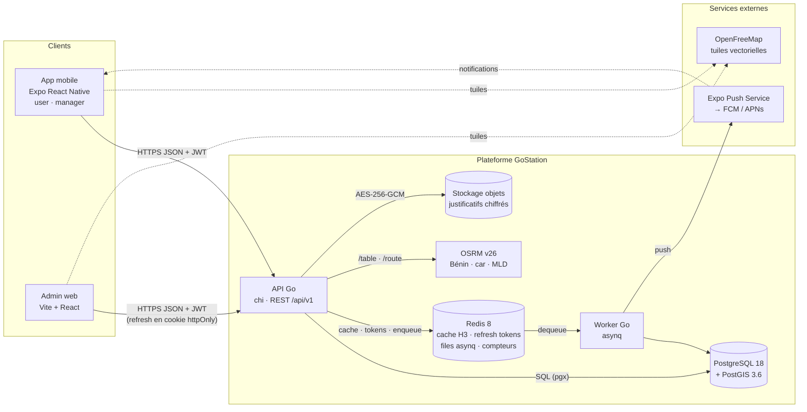
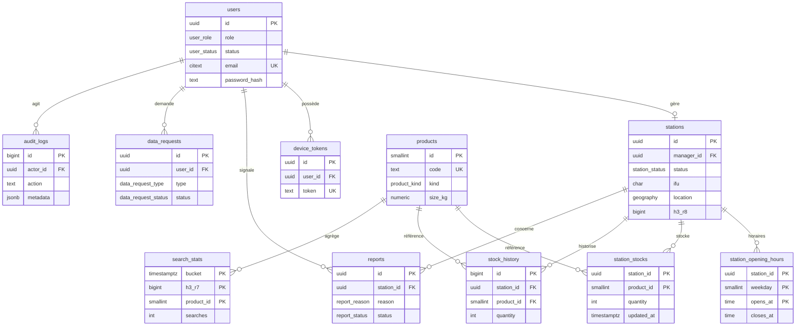
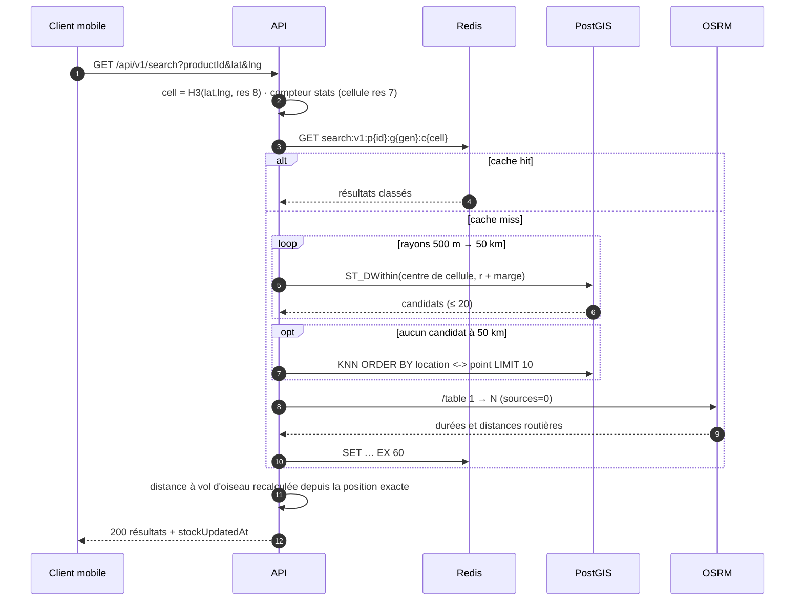

# GoStation — Architecture

> Document prévisionnel (étape 0 : fondations). Il fixe les choix structurants avant le code ; il évoluera avec les migrations goose et les specs d'API.
> Conventions et règles transverses : [`CLAUDE.md`](../CLAUDE.md).

**Sommaire** : 1. Vue d'ensemble · 2. Composants · 3. Modèle de données · 4. Algorithme de recherche · 5. Endpoints API · 6. Authentification et sécurité · 7. Jobs asynchrones · 8. Données personnelles et conservation · 9. Questions ouvertes

---

## 1. Vue d'ensemble



Principes :
- **Un seul binaire Go, deux points d'entrée** (`cmd/api`, `cmd/worker`) qui partagent `internal/`. L'API est sans état : on la scale horizontalement.
- **OSRM n'est jamais exposé publiquement** : l'API le proxifie (`/routes`), ce qui permet le rate limiting et garantit qu'aucune position n'est journalisée.
- **Les tuiles OpenFreeMap sont chargées directement par les clients** (pas de proxy).
- **Le stockage des justificatifs** est un système de fichiers local en dev et un stockage objet compatible S3 en prod (§9, Q5).

## 2. Composants

| Composant | Rôle | Techno |
|---|---|---|
| API | Auth, recherche, gestion des stations et des stocks, back-office admin | Go, chi, pgx v5 + sqlc, go-redis v9, golang-jwt v5, h3-go v4, slog |
| Worker | Rappels de stock, envoi des push, agrégation des stats, purges de conservation, exports de données | asynq (Redis) |
| PostgreSQL + PostGIS | Source de vérité ; requêtes spatiales (`ST_DWithin`, KNN `<->`) | PG 18, PostGIS 3.6, migrations goose |
| Redis | Cache de recherche (H3 + produit), refresh tokens, files asynq, rate limiting, compteurs de stats | Redis 8.10, `noeviction` |
| OSRM | Matrice de temps de trajet (`/table`) et itinéraire (`/route`) | osrm-backend v26.10, MLD |
| Mobile | Recherche, carte, itinéraire (user) ; station, horaires, stocks (manager) | Expo SDK 57, MapLibre RN, TanStack Query, Zustand |
| Web admin | Validation, catalogue, carte, pénuries, signalements, stats, audit, demandes APDP | Vite, React 19, Tailwind 4, shadcn/ui, 21st.dev, TanStack Router/Query, maplibre-gl |

## 3. Modèle de données (prévisionnel)

Conventions : PK `uuid DEFAULT uuidv7()` (natif PG 18, triable dans le temps), `timestamptz` en UTC, enums PostgreSQL, contraintes nommées. Extensions : `postgis`, `citext`.



### 3.1 Types énumérés

```sql
CREATE TYPE user_role           AS ENUM ('user', 'manager', 'admin');
CREATE TYPE user_status         AS ENUM ('active', 'disabled', 'pending_deletion');
CREATE TYPE station_status      AS ENUM ('pending', 'approved', 'rejected', 'suspended');
CREATE TYPE product_kind        AS ENUM ('lpg', 'petrol', 'diesel');   -- gaz domestique, essence, gasoil
CREATE TYPE product_unit        AS ENUM ('cylinder', 'liter');
CREATE TYPE stock_source        AS ENUM ('manager', 'admin', 'system');
CREATE TYPE report_reason       AS ENUM ('stock_incorrect', 'station_closed', 'wrong_location', 'other');
CREATE TYPE report_status       AS ENUM ('open', 'resolved', 'dismissed');
CREATE TYPE data_request_type   AS ENUM ('access', 'export', 'rectification', 'deletion', 'opposition');
CREATE TYPE data_request_status AS ENUM ('pending', 'in_progress', 'completed', 'rejected');
CREATE TYPE device_platform     AS ENUM ('ios', 'android');
```

### 3.2 Tables

```sql
-- Comptes (les trois rôles). Aucune position, aucun téléphone personnel.
CREATE TABLE users (
  id                      uuid PRIMARY KEY DEFAULT uuidv7(),
  role                    user_role   NOT NULL DEFAULT 'user',
  status                  user_status NOT NULL DEFAULT 'active',
  email                   citext      NOT NULL,
  password_hash           text        NOT NULL,             -- argon2id, format PHC (params inclus)
  first_name              text        NOT NULL CHECK (char_length(first_name) BETWEEN 1 AND 100),
  last_name               text        NOT NULL CHECK (char_length(last_name)  BETWEEN 1 AND 100),
  email_verified_at       timestamptz,
  privacy_policy_version  text        NOT NULL,             -- version acceptée à l'inscription
  privacy_accepted_at     timestamptz NOT NULL,
  last_login_at           timestamptz,
  deletion_requested_at   timestamptz,                      -- purge définitive à +30 j (job)
  created_at              timestamptz NOT NULL DEFAULT now(),
  updated_at              timestamptz NOT NULL DEFAULT now(),
  CONSTRAINT uq_users_email UNIQUE (email)
);

-- Stations. V1 : un gérant = une station.
CREATE TABLE stations (
  id                    uuid PRIMARY KEY DEFAULT uuidv7(),
  manager_id            uuid REFERENCES users(id) ON DELETE SET NULL,
  status                station_status NOT NULL DEFAULT 'pending',
  name                  text NOT NULL,
  brand                 text,                                -- marque, normalisée par l'admin
  ifu                   char(13) NOT NULL CHECK (ifu ~ '^[0-9]{13}$'),
  rccm                  text NOT NULL,                       -- format validé côté API
  address               text NOT NULL,
  city                  text,
  phone                 text NOT NULL,                       -- E.164 (+229…)
  location              geography(Point, 4326),              -- NULL tant que non épinglée
  location_set_at       timestamptz,
  h3_r8                 bigint,                              -- cellule H3 res 8 (h3-go), stats et pénuries
  document_object_key   text,                                -- justificatif chiffré (stockage objet)
  document_wrapped_key  bytea,                               -- DEK chiffrée par la KEK (enveloppe)
  document_sha256       bytea,
  document_mime         text CHECK (document_mime IN ('application/pdf', 'image/jpeg', 'image/png')),
  status_reason         text,                                -- motif de rejet ou de suspension
  reviewed_by           uuid REFERENCES users(id) ON DELETE SET NULL,
  reviewed_at           timestamptz,
  last_stock_update_at  timestamptz,                         -- dénormalisé : données périmées et rappels
  last_reminder_at      timestamptz,
  created_at            timestamptz NOT NULL DEFAULT now(),
  updated_at            timestamptz NOT NULL DEFAULT now(),
  CONSTRAINT uq_stations_manager UNIQUE (manager_id)
);
-- Index spatial partiel : ne couvre que ce que la recherche peut renvoyer.
CREATE INDEX idx_stations_location_approved ON stations USING gist (location)
  WHERE status = 'approved' AND location IS NOT NULL;
CREATE INDEX idx_stations_status  ON stations (status, created_at DESC);
CREATE INDEX idx_stations_ifu     ON stations (ifu);           -- non unique : un IFU peut couvrir un réseau (§9)

-- Horaires (ISO 8601 : 1 = lundi). 24 h/24 : 00:00 → 24:00. closes_at < opens_at = passe minuit.
CREATE TABLE station_opening_hours (
  station_id  uuid     NOT NULL REFERENCES stations(id) ON DELETE CASCADE,
  weekday     smallint NOT NULL CHECK (weekday BETWEEN 1 AND 7),
  opens_at    time     NOT NULL,
  closes_at   time     NOT NULL,
  PRIMARY KEY (station_id, weekday, opens_at)
);

-- Catalogue configurable par l'admin (tailles de gaz). Jamais supprimé : désactivé.
CREATE TABLE products (
  id          smallint GENERATED ALWAYS AS IDENTITY PRIMARY KEY,
  code        text NOT NULL UNIQUE,                    -- 'lpg_6kg', 'lpg_12_5kg', 'petrol', 'diesel'
  kind        product_kind NOT NULL,
  unit        product_unit NOT NULL,
  size_kg     numeric(5,2),
  label_fr    text NOT NULL,                           -- « Gaz 12,5 kg »
  is_active   boolean  NOT NULL DEFAULT true,
  sort_order  smallint NOT NULL DEFAULT 0,
  created_at  timestamptz NOT NULL DEFAULT now(),
  updated_at  timestamptz NOT NULL DEFAULT now(),
  CONSTRAINT ck_products_kind_unit CHECK (
    (kind = 'lpg' AND unit = 'cylinder' AND size_kg > 0)
    OR (kind IN ('petrol', 'diesel') AND unit = 'liter' AND size_kg IS NULL)),
  CONSTRAINT uq_products_kind_size UNIQUE NULLS NOT DISTINCT (kind, size_kg)
);

-- Stock courant : bouteilles (gaz) ou litres (carburants).
CREATE TABLE station_stocks (
  station_id  uuid     NOT NULL REFERENCES stations(id) ON DELETE CASCADE,
  product_id  smallint NOT NULL REFERENCES products(id),
  quantity    integer  NOT NULL CHECK (quantity >= 0),
  updated_by  uuid REFERENCES users(id) ON DELETE SET NULL,
  updated_at  timestamptz NOT NULL DEFAULT now(),       -- « mis à jour il y a X min »
  PRIMARY KEY (station_id, product_id)
);
CREATE INDEX idx_station_stocks_available ON station_stocks (product_id, station_id)
  WHERE quantity > 0;

-- Historique des stocks : écrit dans la même transaction que station_stocks (pas de trigger).
CREATE TABLE stock_history (
  id                 bigint GENERATED ALWAYS AS IDENTITY PRIMARY KEY,
  station_id         uuid     NOT NULL REFERENCES stations(id) ON DELETE CASCADE,
  product_id         smallint NOT NULL REFERENCES products(id),
  quantity           integer  NOT NULL,
  previous_quantity  integer,
  source             stock_source NOT NULL,
  changed_by         uuid REFERENCES users(id) ON DELETE SET NULL,
  created_at         timestamptz NOT NULL DEFAULT now()
);
CREATE INDEX idx_stock_history_station ON stock_history (station_id, product_id, created_at DESC);
-- Partitionnement mensuel (RANGE created_at) quand on dépasse ~10 M lignes.

-- Tokens push Expo. Supprimés à la déconnexion, quand Expo renvoie DeviceNotRegistered, ou après 90 j sans activité.
CREATE TABLE device_tokens (
  id            uuid PRIMARY KEY DEFAULT uuidv7(),
  user_id       uuid NOT NULL REFERENCES users(id) ON DELETE CASCADE,
  token         text NOT NULL UNIQUE,                  -- ExponentPushToken[…]
  platform      device_platform NOT NULL,
  app_version   text,
  last_seen_at  timestamptz NOT NULL DEFAULT now(),
  created_at    timestamptz NOT NULL DEFAULT now()
);
CREATE INDEX idx_device_tokens_user ON device_tokens (user_id);

-- Signalements des utilisateurs.
CREATE TABLE reports (
  id               uuid PRIMARY KEY DEFAULT uuidv7(),
  station_id       uuid NOT NULL REFERENCES stations(id) ON DELETE CASCADE,
  product_id       smallint REFERENCES products(id),
  reporter_id      uuid REFERENCES users(id) ON DELETE SET NULL,
  reason           report_reason NOT NULL,
  comment          text CHECK (char_length(comment) <= 500),
  status           report_status NOT NULL DEFAULT 'open',
  resolved_by      uuid REFERENCES users(id) ON DELETE SET NULL,
  resolution_note  text,
  resolved_at      timestamptz,
  created_at       timestamptz NOT NULL DEFAULT now()
);
CREATE INDEX idx_reports_open    ON reports (created_at DESC) WHERE status = 'open';
CREATE INDEX idx_reports_station ON reports (station_id, created_at DESC);

-- Journal d'audit, en ajout seul : le rôle applicatif n'a que INSERT et SELECT. La purge passe par un rôle dédié.
CREATE TABLE audit_logs (
  id           bigint GENERATED ALWAYS AS IDENTITY PRIMARY KEY,
  actor_id     uuid REFERENCES users(id) ON DELETE SET NULL,
  actor_role   user_role,
  action       text NOT NULL,             -- 'station.approve', 'document.view', 'product.update', 'user.purge'…
  entity_type  text NOT NULL,
  entity_id    text,
  metadata     jsonb NOT NULL DEFAULT '{}', -- avant/après, sans donnée personnelle superflue
  request_id   text,
  created_at   timestamptz NOT NULL DEFAULT now()
);
CREATE INDEX idx_audit_logs_entity ON audit_logs (entity_type, entity_id, created_at DESC);
CREATE INDEX idx_audit_logs_actor  ON audit_logs (actor_id, created_at DESC);

-- Demandes d'exercice des droits (APDP / RGPD).
CREATE TABLE data_requests (
  id                 uuid PRIMARY KEY DEFAULT uuidv7(),
  user_id            uuid REFERENCES users(id) ON DELETE SET NULL,
  type               data_request_type   NOT NULL,
  status             data_request_status NOT NULL DEFAULT 'pending',
  details            text,
  due_at             timestamptz NOT NULL,           -- échéance légale (délai à confirmer, §9)
  handled_by         uuid REFERENCES users(id) ON DELETE SET NULL,
  response_note      text,
  export_object_key  text,                           -- archive chiffrée, lien expirant
  created_at         timestamptz NOT NULL DEFAULT now(),
  completed_at       timestamptz
);
CREATE INDEX idx_data_requests_status ON data_requests (status, due_at);

-- Ajout : stats de recherche anonymes, la seule trace des recherches.
-- Les compteurs vivent dans Redis (HINCRBY) et sont vidés ici toutes les 5 min par le worker.
CREATE TABLE search_stats (
  bucket          timestamptz NOT NULL,             -- heure tronquée
  h3_r7           bigint      NOT NULL,             -- cellule ≈ 5 km², jamais la position
  product_id      smallint    NOT NULL REFERENCES products(id),
  searches        integer     NOT NULL DEFAULT 0,
  empty_within_5km integer    NOT NULL DEFAULT 0,   -- aucun stock à ≤ 5 km : signal de pénurie
  PRIMARY KEY (bucket, h3_r7, product_id)
);
```

Données initiales (migration de seed) : `petrol`, `diesel`, et les tailles de gaz courantes (6 kg et 12,5 kg, à confirmer sur le terrain), toutes modifiables par l'admin.

## 4. Algorithme de recherche

**Entrée** : `productId`, `lat`, `lng` (position courante, jamais stockée).
**Sortie** : jusqu'à 10 stations `approved` avec `quantity > 0`, classées par temps de trajet réel.



### 4.1 Étapes

1. **Cache.** `cell = h3.LatLngToCell(lat, lng, 8)`. Clé : `search:v1:p{productId}:g{gen}:c{cell}`, où `gen = GET search:gen:p{productId}`. En cas de hit, on passe à l'étape 5.
   Le calcul se fait depuis le **centre de la cellule**, pas depuis la position exacte. Deux utilisateurs de la même cellule partagent donc le résultat, et la position précise n'entre jamais dans le calcul mis en cache.
2. **Rayons progressifs** `[500, 1000, 2000, 5000, 10000, 25000, 50000]` m. Chaque rayon est augmenté de la distance centre → sommet de la cellule (≈ 0,5 km en res 8) : ainsi aucune station située dans le rayon autour de la position réelle n'est manquée.
   ```sql
   -- name: ListAvailableStationsWithinRadius :many
   SELECT s.id, s.name, s.brand, s.address,
          ST_Y(s.location::geometry) AS lat, ST_X(s.location::geometry) AS lng,
          ss.quantity, ss.updated_at AS stock_updated_at,
          ST_Distance(s.location, @point::geography) AS distance_m
   FROM stations s
   JOIN station_stocks ss ON ss.station_id = s.id
   WHERE ss.product_id = @product_id
     AND ss.quantity > 0
     AND s.status = 'approved'
     AND s.location IS NOT NULL
     AND ST_DWithin(s.location, @point::geography, @radius_m)
   ORDER BY s.location <-> @point::geography
   LIMIT @max_candidates;                       -- SEARCH_MAX_CANDIDATES = 20
   ```
   On s'arrête au premier rayon qui renvoie au moins `SEARCH_MIN_RESULTS` candidats (3 par défaut, pour que le re-classement OSRM ait du sens ; mettre 1 pour le comportement strict). Si le dernier rayon ne renvoie que 1 ou 2 candidats, on les garde.
   `@point` = `ST_SetSRID(ST_MakePoint(lng, lat), 4326)` : **lng d'abord**.
3. **Repli KNN illimité** si rien n'est trouvé à 50 km : même requête sans `ST_DWithin`, `LIMIT 10`. L'opérateur `<->` sur `geography` utilise l'index GiST. On renvoie donc toujours un résultat tant qu'une station du pays a du stock ; sinon `strategy: "none"` et l'UI propose d'autres tailles ou produits.
4. **Re-classement OSRM.** `GET /table/v1/driving/{lng,lat};{s1};…;{sN}?sources=0&annotations=duration,distance`, timeout `OSRM_TIMEOUT` (800 ms).
   - On trie par `duration` croissante. Une durée `null` (non joignable par la route) passe en fin de liste.
   - Si OSRM échoue ou dépasse le timeout, on garde l'ordre par distance, `ranking: "distance"`, et on ne met **pas** le résultat en cache.
   - On tronque à 10 résultats.
   - `SET` de la clé avec `EX = SEARCH_CACHE_TTL` (60 s).
5. **Réponse.** L'API recalcule `distanceM` (haversine) depuis la position exacte, en mémoire. La durée affichée est celle calculée depuis le centre de la cellule (≈), suffisante pour classer ; l'itinéraire précis vient de `/routes`.

### 4.2 Invalidation du cache

Toute écriture qui peut changer un résultat incrémente une **génération** : `INCR search:gen:p{productId}`. Les anciennes clés deviennent inaccessibles immédiatement et expirent par TTL. Sont concernées :
- mise à jour de stock (le produit concerné) ;
- changement de statut, de position ou d'horaires d'une station (tous les produits) ;
- activation ou désactivation d'un produit.

On utilise des générations plutôt que `DEL` par motif, car une station qui repasse de 0 à > 0 doit apparaître dans des cellules dont le cache ne la contient pas encore ; un index inverse ne suffit pas. À l'échelle du Bénin (quelques milliers de stations), invalider tout le produit reste bon marché.
Évolution possible si le taux de hit baisse : une génération par cellule H3 res 5 et par produit, incrémentée sur le `gridDisk` couvrant 50 km autour de la station modifiée, plus une génération globale réservée aux résultats issus du repli KNN.

### 4.3 Réponse

```json
{
  "product": { "id": 2, "code": "lpg_12_5kg", "label": "Gaz 12,5 kg", "unit": "cylinder" },
  "strategy": "radius",
  "radiusM": 2000,
  "ranking": "duration",
  "results": [
    {
      "station": { "id": "0192…", "name": "Station Akpakpa", "brand": "…", "address": "…",
                   "location": { "lat": 6.3601, "lng": 2.4498 }, "isOpenNow": true },
      "quantity": 14,
      "stockUpdatedAt": "2026-10-10T14:03:00Z",
      "distanceM": 1830,
      "durationS": 420,
      "routeDistanceM": 2400
    }
  ],
  "generatedAt": "2026-10-10T14:05:12Z"
}
```
« Mis à jour il y a X min » est calculé côté client à partir de `stockUpdatedAt` : le texte reste juste même quand la réponse vient du cache.

### 4.4 Points d'attention
- **Ordre des coordonnées** : JSON `{lat,lng}`, mais PostGIS (`ST_MakePoint`) et OSRM attendent `lng,lat`. Des tests unitaires dédiés couvrent ce point.
- **Lagune de Cotonou** : la distance à vol d'oiseau trompe souvent (il faut passer par les ponts), d'où le minimum de 3 candidats avant le re-classement.
- **Hors du Bénin** (frontières) : OSRM ne couvre que l'extrait ; on gère les durées `null` et le code `NoRoute` sans échouer.
- **Performance cible** : p95 < 150 ms sur miss, < 20 ms sur hit. Vérifier avec `EXPLAIN (ANALYZE, BUFFERS)` que l'index GiST partiel est bien utilisé.

## 5. Endpoints API (prévus)

Préfixe `/api/v1`, JSON, erreurs RFC 9457. Sondes `GET /healthz` (vivant) et `GET /readyz` (PG, Redis, OSRM) hors préfixe. 🔒 = JWT requis.

### Public
| Méthode | Route | Description |
|---|---|---|
| POST | `/auth/register` | Inscription `user` (prénom, nom, email, mot de passe, version de politique acceptée) |
| POST | `/auth/register/manager` | Inscription gérant + station (multipart : champs + justificatif PDF/JPG/PNG ≤ 5 Mo) → station `pending` |
| POST | `/auth/login` | Email + mot de passe → access + refresh |
| POST | `/auth/refresh` | Rotation du refresh token (corps JSON sur mobile, cookie httpOnly sur web) |
| POST | `/auth/logout` | Révoque la famille de refresh tokens |
| POST | `/auth/password/forgot` | Envoi d'un code ou lien (réponse identique que l'email existe ou non) |
| POST | `/auth/password/reset` | Nouveau mot de passe ; révoque toutes les sessions |
| GET | `/products` | Catalogue actif |

### Tout utilisateur connecté 🔒
| Méthode | Route | Description |
|---|---|---|
| GET / PATCH | `/me` | Profil (prénom, nom) |
| PUT | `/me/password` | Changement de mot de passe ; révoque les autres sessions |
| DELETE | `/me` | Suppression du compte (mot de passe requis) : désactivation immédiate, purge à 30 j |
| POST / GET | `/me/data-requests` | Exercice des droits : accès, export, rectification, opposition ; suivi |
| POST | `/me/devices` | Enregistre ou rafraîchit le token push Expo |
| DELETE | `/me/devices/{token}` | Désenregistre l'appareil |

### Recherche et itinéraire 🔒 (tous rôles)
| Méthode | Route | Description |
|---|---|---|
| GET | `/search?productId&lat&lng` | Recherche (§4) |
| GET | `/stations/{id}` | Fiche publique d'une station `approved` : infos, horaires, stocks > 0 avec leur âge |
| GET | `/routes?fromLat&fromLng&stationId` | Itinéraire OSRM proxifié (`polyline6`, étapes, durée) ; origine jamais journalisée |
| POST | `/stations/{id}/reports` | Signalement (limité à 3 par jour, par utilisateur et par station) |

### Gérant 🔒 `manager`
Toutes les routes exigent une station `approved`, sauf celles marquées *.

| Méthode | Route | Description |
|---|---|---|
| GET | `/manager/station` * | Ma station, son statut et le motif éventuel |
| PATCH | `/manager/station` * | Nom, adresse, téléphone, marque. Une modification de l'IFU ou du RCCM renvoie la station en `pending`. |
| PUT | `/manager/station/document` * | Renvoi du justificatif (après un `rejected`) |
| PUT | `/manager/station/location` | Épinglage `{ lat, lng, confirmStationLocation: true }` : l'avertissement UI doit être acquitté. Recalcule `h3_r8` et invalide le cache. |
| GET / PUT | `/manager/station/opening-hours` | Lecture / remplacement de la semaine complète |
| GET | `/manager/station/stocks` | Stocks courants |
| PUT | `/manager/station/stocks` | Mise à jour groupée `[{ productId, quantity }]`. Idempotente, écrit `stock_history`, met à jour `last_stock_update_at`, incrémente la génération. |
| GET | `/manager/station/stocks/history?productId&from&to` | Historique |

### Admin 🔒 `admin` (chaque mutation écrit dans `audit_logs`)
| Méthode | Route | Description |
|---|---|---|
| GET | `/admin/stations?status&q&cursor` | Stations et demandes de gérants (par défaut `pending`) |
| GET | `/admin/stations/{id}` | Détail, historique de statut, signalements |
| GET | `/admin/stations/{id}/document` | Justificatif déchiffré à la volée (streaming, `Cache-Control: no-store`, audité) |
| POST | `/admin/stations/{id}/approve` · `/reject` · `/suspend` · `/reinstate` | Transitions de statut (`{ reason }` obligatoire pour reject et suspend) ; push au gérant |
| GET | `/admin/map/stations?bbox&productId&status` | GeoJSON pour la carte (clustering côté client) |
| GET / POST | `/admin/products` | Catalogue |
| PATCH | `/admin/products/{id}` | Libellé, ordre, activation (pas de suppression) |
| GET | `/admin/shortage-zones?productId&from&to` | Cellules H3 res 7 en GeoJSON : demande et absence de stock (k ≥ 5) |
| GET | `/admin/stale-stocks?olderThan=6h` | Stations ouvertes dont le stock n'a pas été mis à jour depuis plus que le seuil |
| GET | `/admin/reports?status&cursor` | Signalements |
| PATCH | `/admin/reports/{id}` | Résoudre ou classer |
| GET | `/admin/stats/overview` · `/admin/stats/searches?productId&granularity` | Indicateurs (stations, stocks, recherches agrégées) |
| GET | `/admin/audit-logs?actorId&entityType&from&to&cursor` | Journal d'audit |
| GET | `/admin/data-requests?status` | Demandes APDP |
| PATCH | `/admin/data-requests/{id}` | Traitement (statut, note, génération d'export) |
| GET | `/admin/users?role&q&cursor` | Comptes |
| PATCH | `/admin/users/{id}` | Désactivation / réactivation (révoque les sessions) |

Les comptes admin se créent uniquement via la CLI `cmd/admin` : aucune route publique.

## 6. Authentification et sécurité

- **Mots de passe** : argon2id, paramètres RFC 9106 (m = 64 MiB, t = 3, p = 4, sel de 16 o, tag de 32 o), stockés au format PHC. Re-hash automatique au login si les paramètres changent. Un sémaphore borne les hachages concurrents (mémoire).
- **Access token** : JWT HS256, 15 min. Claims : `sub` (user id), `role`, `sid` (famille de session), `iss`, `iat`, `exp`, `jti`.
- **Refresh token** : 256 bits aléatoires (base64url), opaques, rotatifs, valables 30 j. Redis :
  - `auth:rt:{sha256(token)}` → `{uid, fid, exp}` (TTL = expiration) ;
  - `auth:fam:{fid}` → hash du token courant ;
  - `auth:user:{uid}:fams` → ensemble des familles (déconnexion globale).

  La rotation est atomique (script Lua) : l'ancien token est marqué `used`. **Réutiliser un token déjà consommé révoque toute la famille** (détection de vol).
- **Stockage côté client** : sur mobile, les deux tokens vont dans `expo-secure-store`. Sur le web, l'access token reste en mémoire et le refresh token va dans un cookie `HttpOnly; Secure; SameSite=Strict; Path=/api/v1/auth`.
- **Autorisation** : middleware de rôle et vérification du statut de la station en base pour les routes gérant (un JWT de 15 min ne suffit pas à refléter une suspension).
- **Rate limiting** (Redis, fenêtre glissante) :

  | Action | Limite |
  |---|---|
  | Login | 5/min par IP et par email |
  | Inscription | 5/h par IP |
  | Recherche | 60/min par utilisateur |
  | `/routes` | 30/min |
  | Signalements | 3/jour par station |

- **Divers** : CORS limité à `CORS_ALLOWED_ORIGINS`. En-têtes de sécurité. Taille des corps bornée (5 Mo pour le multipart). Type MIME réel des justificatifs vérifié par lecture des magic bytes.
- **Chiffrement des justificatifs** : par enveloppe. Une DEK AES-256-GCM aléatoire par fichier, elle-même chiffrée par la KEK `DOCUMENTS_ENCRYPTION_KEY` (KMS en prod). La KEK est versionnée pour permettre sa rotation.

## 7. Jobs asynchrones (asynq)

| Tâche | Déclenchement | Rôle |
|---|---|---|
| `stock:reminders:scan` | Toutes les 15 min | Stations `approved` **ouvertes maintenant** (fuseau `Africa/Porto-Novo`) avec `last_stock_update_at` et `last_reminder_at` plus vieux que 4 h → `push:send` au gérant |
| `push:send` | À la demande | Envoi par lots de 100 vers l'Expo Push API, puis lecture des reçus : `DeviceNotRegistered` supprime le token |
| `stats:flush` | Toutes les 5 min | Compteurs Redis → `search_stats` (upsert) |
| `retention:purge` | Chaque jour à 03:00 | Purges selon §8 |
| `data-requests:export` | À la demande | Archive JSON des données d'un utilisateur, chiffrée, lien valable 7 j |

Les tâches sont idempotentes (clé d'unicité asynq), avec retry et backoff exponentiel, et une file `critical` séparée pour les push.

## 8. Données personnelles et conservation

| Donnée | Base légale / finalité | Conservation proposée* |
|---|---|---|
| Position de l'utilisateur | Exécution du service (recherche, itinéraire) | **Aucune** : traitée en mémoire, jamais journalisée |
| Stats de recherche (H3 res 7, par heure) | Intérêt légitime (pénuries) | 24 mois, déjà anonymes |
| Compte utilisateur | Contrat | Durée du compte ; purge 30 j après la demande de suppression |
| Comptes inactifs | Minimisation | Relance à 24 mois, suppression à 36 mois |
| Justificatif IFU d'une station approuvée | Obligation de vérification | Tant que la station est active + 12 mois |
| Justificatif d'une demande rejetée | Idem | 90 j après le rejet |
| Refresh tokens | Sécurité | 30 j (TTL Redis) |
| Tokens push | Exécution du service | Jusqu'à la déconnexion, ou 90 j sans activité |
| Historique des stocks | Intérêt légitime (fiabilité, stats) | 24 mois, puis agrégé |
| Signalements | Modération | 12 mois après résolution ; `reporter_id` mis à NULL à la suppression du compte |
| Journal d'audit | Sécurité, responsabilité | 12 mois |
| Demandes d'exercice des droits | Preuve de conformité | 3 ans après clôture |
| Logs applicatifs (sans position ni token) | Sécurité | 30 j |

\* Durées à valider avec un juriste ou DPO au regard du Code du numérique (Livre V) et des délibérations de l'APDP.

## 9. Questions ouvertes

1. **Stations fermées** : faut-il les afficher avec un badge « Fermé, ouvre à 6 h » et les classer après les stations ouvertes, ou les exclure de la recherche ?
2. **Données périmées** : au-delà de quel âge un stock est-il signalé (proposition : 6 h) ou masqué (proposition : 24 h) ?
3. **Réseaux de stations** : un gérant peut-il gérer plusieurs stations, et plusieurs stations peuvent-elles partager un même IFU ? (Le modèle actuel suppose un gérant = une station et ne rend pas l'IFU unique.)
4. **Recherche sans compte** : faut-il ouvrir la recherche en anonyme (moins de friction) ou garder un compte obligatoire comme le prévoit la spec ?
5. **Hébergement** : où héberger les données (contraintes APDP sur les transferts hors du Bénin) ? Quel stockage objet en prod (S3 compatible ou MinIO auto-hébergé) ?
6. **Vérification à l'inscription** : vérification de l'email ? OTP SMS pour les gérants ?
7. **Délais légaux** : délai de réponse aux demandes APDP et durées de conservation (§8), à confirmer.
8. **Admins** : 2FA TOTP dès la V1 ?
9. **Prix** des carburants et du gaz : hors périmètre V1 ?
