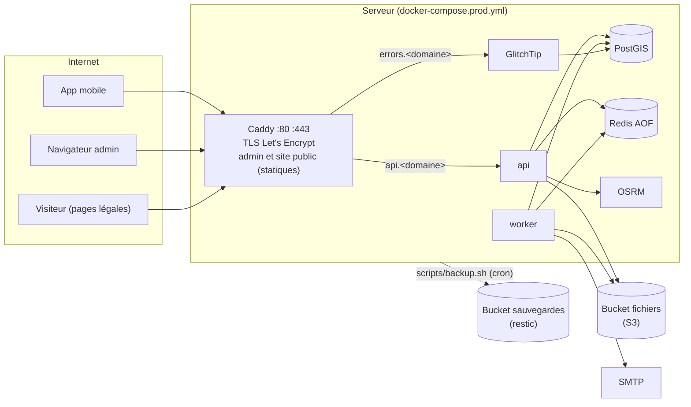

# Déploiement — runbook

> Indépendant du fournisseur : un VPS Ubuntu, un domaine, un SMTP, deux buckets S3. Tout le reste tourne dans `docker-compose.prod.yml` et se pilote par `scripts/prod.sh`. Répété de bout en bout en local le 2026-10-21 (§13). Fichiers : `docker-compose.prod.yml`, `deploy/` (Caddyfile, image du proxy, init de PostgreSQL), `.env.production.example`, `scripts/{gen-prod-secrets,prod,backup,restore}.sh`.

**Sommaire** : 1. Vue d'ensemble · 2. Prérequis · 3. Serveur · 4. Pare-feu · 5. Docker · 6. DNS et email · 7. Stockage S3 · 8. Premier déploiement · 9. Mise à jour · 10. Sauvegarde · 11. Restauration · 12. Retour arrière · 13. Répéter en local · 14. Secrets · 15. Supervision · 16. Dépannage

## 1. Vue d'ensemble



| Site | Contenu |
|---|---|
| `https://<domaine>` | Site public : politique de confidentialité, CGU, **suppression de compte** (`/suppression-compte`, lien pour Google Play) |
| `https://api.<domaine>` | API (en-têtes de sécurité posés par l'API) |
| `https://admin.<domaine>` | Admin web (build statique, CSP stricte de `Web/dist/csp.txt`) |
| `https://errors.<domaine>` | GlitchTip (rapports de plantage, D90) ; l'IP des clients ne lui parvient pas |

Seul Caddy publie des ports. PostgreSQL, Redis, OSRM, l'API, le worker et GlitchTip ne sont joignables que sur le réseau Docker interne (`172.31.0.0/24`, Caddy en `172.31.0.10`, seule adresse dont l'API accepte `X-Forwarded-For`).

## 2. Prérequis

| Élément | Exigence |
|---|---|
| VPS | Ubuntu Server LTS (26.04 ou 24.04), **2 vCPU, 4 Go de RAM**, 40 Go SSD, IPv4 publique (IPv6 bienvenue). Localisation : à arbitrer avec le juriste (APDP, transferts hors du Bénin, D4) |
| Domaine | Un domaine dont vous gérez la zone DNS (5 enregistrements, §6) |
| SMTP | Un service d'envoi transactionnel avec STARTTLS ou TLS (port 587 ou 465), un domaine d'envoi vérifié (SPF, DKIM, DMARC), identifiants SMTP |
| Stockage S3 | Deux buckets privés chez un fournisseur compatible S3 : `…-files` (fichiers chiffrés de l'app) et `…-backups` (restic), chacun avec sa clé d'accès limitée à son bucket ; idéalement les sauvegardes dans une autre région ou chez un autre fournisseur |
| Expo | `EXPO_ACCESS_TOKEN` (déjà dans le `.env` de dev), accès au projet EAS `@hen_ry/gostation` |
| Poste d'exploitation | Un coffre de mots de passe pour `DOCUMENTS_ENCRYPTION_KEY`, `RESTIC_PASSWORD` et les identifiants des buckets |

## 3. Serveur

Connecté en root la première fois (ou avec l'utilisateur fourni par l'hébergeur) :

```bash
timedatectl set-timezone UTC                      # horodatages en UTC ; l'app gère Africa/Porto-Novo
apt update && apt full-upgrade -y
apt install -y git ufw fail2ban unattended-upgrades python3 openssl
dpkg-reconfigure -plow unattended-upgrades        # mises à jour de sécurité automatiques
adduser --disabled-password --gecos "" deploy
mkdir -p /home/deploy/.ssh && cp ~/.ssh/authorized_keys /home/deploy/.ssh/ && chown -R deploy: /home/deploy/.ssh
# SSH : clés seulement, pas de root
sed -i 's/^#\?PasswordAuthentication .*/PasswordAuthentication no/; s/^#\?PermitRootLogin .*/PermitRootLogin no/' /etc/ssh/sshd_config
systemctl reload ssh
# 2 Go de swap (marge pour les builds Node et Go)
fallocate -l 2G /swapfile && chmod 600 /swapfile && mkswap /swapfile && swapon /swapfile
echo '/swapfile none swap sw 0 0' >> /etc/fstab
```

Vérifier qu'une nouvelle session `ssh deploy@<ip>` fonctionne avant de fermer la session root.

## 4. Pare-feu

```bash
ufw default deny incoming && ufw default allow outgoing
ufw allow OpenSSH
ufw allow 80/tcp && ufw allow 443/tcp && ufw allow 443/udp   # HTTP (ACME, redirection), HTTPS, HTTP/3
ufw enable && ufw status verbose
```

Docker écrit ses propres règles iptables pour les ports publiés : ufw ne les filtre pas. C'est sans risque ici, seul Caddy publie des ports (80 et 443). Ne jamais ajouter de `ports:` à un autre service de `docker-compose.prod.yml`.

## 5. Docker

Dépôt officiel Docker (Engine et plugin Compose v2) :

```bash
install -m 0755 -d /etc/apt/keyrings
curl -fsSL https://download.docker.com/linux/ubuntu/gpg -o /etc/apt/keyrings/docker.asc
echo "deb [arch=$(dpkg --print-architecture) signed-by=/etc/apt/keyrings/docker.asc] https://download.docker.com/linux/ubuntu $(. /etc/os-release && echo "$VERSION_CODENAME") stable" > /etc/apt/sources.list.d/docker.list
apt update && apt install -y docker-ce docker-ce-cli containerd.io docker-buildx-plugin docker-compose-plugin
usermod -aG docker deploy
docker compose version    # v2.24 ou plus (balises !override de la répétition)
```

## 6. DNS et email

Avant le premier déploiement (Let's Encrypt valide chaque nom par HTTP) :

| Nom | Type | Valeur |
|---|---|---|
| `<domaine>` | A (et AAAA) | IP du serveur |
| `www.<domaine>` | A (et AAAA) | IP du serveur (redirigé vers `<domaine>`) |
| `api.<domaine>` | A (et AAAA) | IP du serveur |
| `admin.<domaine>` | A (et AAAA) | IP du serveur |
| `errors.<domaine>` | A (et AAAA) | IP du serveur |

Email (chez le fournisseur SMTP, pour le domaine de `SMTP_FROM`) : SPF (`TXT v=spf1 include:<fournisseur> -all`), DKIM (clé fournie), DMARC (`_dmarc TXT v=DMARC1; p=quarantine; rua=mailto:…`). Contrôle : `dig +short TXT <domaine>`, puis un email de test depuis l'app (vérification d'adresse) arrivé hors spam.

`admin.<domaine>` et `api.<domaine>` doivent rester sous le même domaine : les cookies `SameSite=Strict` de l'admin en dépendent (D43).

## 7. Stockage S3

1. Créer le bucket des fichiers (privé, sans site web, sans accès public) et une clé limitée à ce bucket (lecture, écriture, suppression). Le bucket ne reçoit que des fichiers déjà chiffrés par l'application (enveloppe AES-256-GCM).
2. Créer le bucket des sauvegardes et une clé dédiée. Activer si possible le versionnage ou un verrouillage d'objets (une compromission du serveur ne doit pas pouvoir effacer l'historique) ; restic chiffre tout (AES-256) avec `RESTIC_PASSWORD`.
3. Renseigner dans `.env.production` : `S3_ENDPOINT` (hôte sans `https://`), `S3_REGION`, `S3_BUCKET`, `S3_ACCESS_KEY_ID`, `S3_SECRET_ACCESS_KEY`, `S3_PATH_STYLE` (`true` si le fournisseur l'exige), puis `RESTIC_REPOSITORY=s3:https://<hôte>/<bucket-sauvegardes>`, `BACKUP_S3_ACCESS_KEY_ID`, `BACKUP_S3_SECRET_ACCESS_KEY` (et `BACKUP_S3_REGION` si la région n'est pas `us-east-1`).

Sans S3, `STORAGE_DRIVER=local` garde les fichiers dans le volume `documents` (sauvegardé lui aussi) : acceptable pour un staging.

## 8. Premier déploiement

En tant que `deploy` :

```bash
sudo mkdir -p /srv/gostation /var/lib/gostation-backup && sudo chown deploy: /srv/gostation /var/lib/gostation-backup
git clone https://github.com/Hen17Ry/gostation.git /srv/gostation && cd /srv/gostation
scripts/gen-prod-secrets.sh          # .env.production (600), secrets aléatoires
nano .env.production                 # remplacer chaque fill-me (domaine, SMTP, S3, Expo, contact)
scripts/prod.sh check                # refuse tant qu'il reste un fill-me ou un change-me
```

Copier tout de suite dans le coffre de mots de passe : `DOCUMENTS_ENCRYPTION_KEY` (sans elle, les justificatifs sont perdus), `RESTIC_PASSWORD` (sans lui, les sauvegardes sont illisibles), `APP_SECRET`, les clés S3.

```bash
scripts/prod.sh osrm-prepare         # extrait Bénin (~50 Mo) et graphe OSRM (~1 min)
scripts/prod.sh deploy               # build api + proxy, migrations, démarrage, attente des healthchecks
scripts/prod.sh admin-create ada@<domaine> Ada Admin   # mot de passe saisi au clavier, 2FA au premier login
```

Contrôles :

```bash
curl -s https://api.<domaine>/readyz                  # {"status":"ready",…}
curl -sI https://admin.<domaine>/ | grep -i content-security-policy
curl -sI https://<domaine>/suppression-compte | head -1
scripts/prod.sh ps                                    # tout healthy
```

Puis se connecter à `https://admin.<domaine>` (configuration de la 2FA, 10 codes de secours à garder).

**GlitchTip** (suivi des plantages, D90) :

1. `scripts/prod.sh glitchtip-superuser` (email et mot de passe du premier compte ; l'inscription publique est fermée). Au tout premier démarrage, GlitchTip crée son schéma : `errors.<domaine>` répond 502 pendant une à deux minutes.
2. Sur `https://errors.<domaine>` : créer l'organisation GoStation et trois projets, `api` (Go), `admin` (JavaScript), `mobile` (React Native) ; noter les trois DSN.
3. Dans `.env.production` : `SENTRY_DSN` (projet api, utilisé par l'API et le worker), `VITE_SENTRY_DSN` (projet admin, figé dans le build : redéployer). `scripts/prod.sh deploy`.

**App mobile** : variables EAS de l'environnement `production` (et `preview` pour le staging), puis un nouveau build :

```bash
cd Mobile
eas env:create --environment production --name EXPO_PUBLIC_API_URL --value https://api.<domaine> --visibility plaintext
eas env:create --environment production --name EXPO_PUBLIC_SENTRY_DSN --value <DSN du projet mobile> --visibility plaintext
eas build --profile production --platform android
```

**Google Play** : URL de la politique `https://<domaine>/politique-confidentialite`, URL de suppression de compte `https://<domaine>/suppression-compte`.

**Base déjà initialisée** (PostgreSQL créé avant l'ajout de GlitchTip) : le script `deploy/postgres/init/20-glitchtip.sh` ne s'exécute que sur une base vide. Le jouer à la main une fois :

```bash
docker compose -p gostation-prod exec -T postgres bash /docker-entrypoint-initdb.d/20-glitchtip.sh
```

## 9. Mise à jour

```bash
cd /srv/gostation && git pull
scripts/prod.sh deploy
```

`deploy` met à jour les images tierces épinglées, reconstruit l'API et le proxy (étiquetés par `git describe`), applique les migrations puis recrée les services modifiés. L'API est indisponible quelques secondes pendant son remplacement (Caddy répond 502). Après un changement de `.env.example` côté backend, reporter la variable dans `.env.production` (même nom) avant le déploiement.

Images Docker : `docker image prune` de temps en temps, en gardant les deux ou trois dernières versions de `gostation-api` et `gostation-proxy` (retour arrière).

## 10. Sauvegarde

Quotidienne, par cron (utilisateur `deploy`), à 2 h 30 (les purges de conservation tournent à 3 h, heure du Bénin) :

```bash
crontab -e
30 1 * * * cd /srv/gostation && scripts/prod.sh backup >> /var/lib/gostation-backup/backup.log 2>&1
```

(1 h 30 UTC = 2 h 30 à Porto-Novo.) Chaque passage :

1. `pg_dump -Fc` de la base GoStation ;
2. les fichiers : miroir incrémental du bucket (rclone) ou volume local ;
3. `.env.production` (nécessaire pour relire les fichiers) ;
4. `restic backup` vers `RESTIC_REPOSITORY` (chiffré, dédupliqué), puis `restic forget --prune` : **7 quotidiennes, 4 hebdomadaires, 3 mensuelles** (une donnée purgée disparaît des sauvegardes 3 mois au plus après, durée indiquée dans la politique) ;
5. `restic check` sur un septième des données (tout le dépôt chaque semaine).

Non sauvegardés : Redis (sessions, files, quotas, cache : après une restauration, tout le monde se reconnecte), GlitchTip, certificats. Lister les sauvegardes : `scripts/prod.sh snapshots`. Surveiller `backup.log` (ou ajouter un ping vers un service de surveillance de tâches cron en fin de commande).

## 11. Restauration

**Sur le même serveur** (base corrompue, erreur humaine) :

```bash
scripts/prod.sh snapshots                 # choisir l'identifiant, ou « latest »
scripts/prod.sh restore <snapshot>        # confirmation à taper ; --yes pour un script
```

Le script arrête l'API et le worker, recrée la base et y restaure le dump, remet les fichiers (bucket synchronisé : les objets créés après la sauvegarde sont supprimés), vide Redis, rejoue les migrations, redémarre et affiche le nombre de comptes et de stations.

**Sur un nouveau serveur** (perte du serveur) : §3 à §6, puis

```bash
git clone https://github.com/Hen17Ry/gostation.git /srv/gostation && cd /srv/gostation
# .env.production minimal, depuis le coffre : RESTIC_REPOSITORY, RESTIC_PASSWORD,
# BACKUP_S3_ACCESS_KEY_ID, BACKUP_S3_SECRET_ACCESS_KEY (chmod 600)
scripts/prod.sh restore env latest        # récupère le .env.production sauvegardé
mv .env.production.restored .env.production
scripts/prod.sh osrm-prepare && scripts/prod.sh deploy
scripts/prod.sh restore latest --yes
```

Mettre à jour le DNS si l'IP a changé. Les sessions et les files d'attente repartent de zéro.

## 12. Retour arrière

```bash
scripts/prod.sh versions                  # versions construites sur ce serveur
scripts/prod.sh rollback <version>        # api, worker et proxy sur les images de cette version
```

Les migrations ne sont jamais annulées automatiquement. Règle de développement : une migration doit rester compatible avec la version précédente du code (ajouter avant d'utiliser, supprimer une version plus tard). Si une version a modifié le schéma de façon incompatible : restaurer la sauvegarde prise avant le déploiement (§11) ; en lancer une juste avant tout déploiement risqué (`scripts/prod.sh backup`).

## 13. Répéter en local

Toute la chaîne (build, migrations, TLS, GlitchTip, stockage S3, sauvegarde, restauration) se rejoue sur un poste avec Docker, sans domaine : `DOMAIN=gostation.localhost` (Caddy signe lui-même les certificats des noms `*.localhost`), SeaweedFS sert de stockage objet et de dépôt restic, Mailpit reçoit les emails (`deploy/rehearsal.compose.yml`, ports liés à 127.0.0.1).

```bash
scripts/gen-prod-secrets.sh .env.rehearsal
# DOMAIN=gostation.localhost, APP_ENV=staging, S3_ENDPOINT=s3:8333, S3_TLS=false, S3_PATH_STYLE=true,
# S3_BUCKET=gostation, clés rehearsal / rehearsal-secret, SMTP_HOST=mailpit SMTP_PORT=1025 SMTP_TLS=none,
# RESTIC_REPOSITORY=s3:http://s3:8333/gostation-backups, GLITCHTIP_EMAIL_URL=smtp://mailpit:1025
export GOSTATION_ENV_FILE=$PWD/.env.rehearsal GOSTATION_EXTRA_COMPOSE=deploy/rehearsal.compose.yml
export BACKUP_WORK_DIR=$PWD/var/backup-work      # sans droits root sur /var/lib
scripts/prod.sh check && scripts/prod.sh osrm-prepare && scripts/prod.sh deploy
curl -sk https://api.gostation.localhost/readyz
scripts/prod.sh backup && scripts/prod.sh restore latest --yes
docker compose -p gostation-prod down -v   # tout supprimer ensuite (données de test comprises)
```

Répétition du 2026-10-21 : 9 services sains, seul Caddy publie des ports ; en-têtes vérifiés sur chaque site ; inscription d'un gérant avec justificatif à travers le proxy (fichier chiffré dans le bucket, email reçu) ; admin créé par `scripts/prod.sh admin-create` ; sauvegarde, destruction de la base et du fichier, restauration : comptes, station et objet revenus (même somme de contrôle), justificatif relu par l'admin et déchiffré à l'identique ; un événement envoyé à GlitchTip avec des en-têtes `X-Forwarded-For` et `X-Real-IP` falsifiés n'a conservé aucune adresse. Elle a corrigé trois défauts avant tout serveur réel : le script d'init masquait celui de PostGIS, `APP_ENV` était imposé à `production`, et le journal d'erreurs de Caddy contenait l'IP et l'URL des clients.

## 14. Secrets

| Secret | Rotation |
|---|---|
| `JWT_SIGNING_KEYS` | Ajouter une nouvelle clé **en tête** (`kNEW:hex,kOLD:hex`), déployer, retirer l'ancienne 15 min plus tard |
| `RATE_LIMIT_KEY` | Remplacer et redéployer : seuls les compteurs (1 h au plus) repartent de zéro |
| `REDIS_PASSWORD`, `POSTGRES_PASSWORD`, `GLITCHTIP_DB_PASSWORD` | Changer dans le service (`ALTER ROLE … PASSWORD`, puis `.env.production`), redéployer |
| `APP_SECRET` | À éviter : invalide les codes en cours, le CSRF des sessions admin et **déchiffre les secrets TOTP** (2FA à reconfigurer pour chaque admin) |
| `DOCUMENTS_ENCRYPTION_KEY` | Jamais sans procédure de rechiffrement : les fichiers existants deviendraient illisibles |
| `RESTIC_PASSWORD` | `restic key add` puis `restic key remove` (le dépôt reste lisible) |
| Clés S3, SMTP, `EXPO_ACCESS_TOKEN` | Créer la nouvelle chez le fournisseur, mettre à jour `.env.production`, redéployer, révoquer l'ancienne |

`.env.production` reste en 600, appartient à `deploy`, n'est jamais copié ailleurs qu'au coffre et dans les sauvegardes chiffrées.

## 15. Supervision

- `scripts/prod.sh ps` (healthchecks), `scripts/prod.sh logs api` (journaux JSON sans IP, position ni email, rotation 3 × 10 Mo par service).
- GlitchTip : erreurs 5xx, panics, tâches en échec définitif, plantages de l'admin et de l'app (alertes par email à configurer dans chaque projet).
- Espace disque : `df -h /var/lib/docker` (PostgreSQL, OSRM, images).
- Externe (recommandé) : une sonde sur `https://api.<domaine>/healthz` toutes les minutes.

## 16. Dépannage

| Symptôme | Piste |
|---|---|
| Certificat non émis | DNS pas encore propagé (`dig +short api.<domaine>`), port 80 bloqué ; `scripts/prod.sh logs caddy` |
| `api` jamais healthy | `scripts/prod.sh logs api` : configuration refusée au démarrage (message par variable) ou base injoignable |
| `/readyz` : `osrm: fail` | Données OSRM absentes : `scripts/prod.sh osrm-prepare` ; la recherche continue à vol d'oiseau |
| Emails non reçus | `scripts/prod.sh logs worker` (code SMTP), SPF/DKIM, `SMTP_TLS` |
| Fichiers illisibles après une restauration | `DOCUMENTS_ENCRYPTION_KEY` différente de celle de la sauvegarde : reprendre celle du `.env.production` sauvegardé |
| GlitchTip ne reçoit rien | DSN vide ou erroné ; `errors.<domaine>` résolu ; pour l'admin, origine du DSN absente de la CSP (rebuild après avoir renseigné `VITE_SENTRY_DSN`) |
