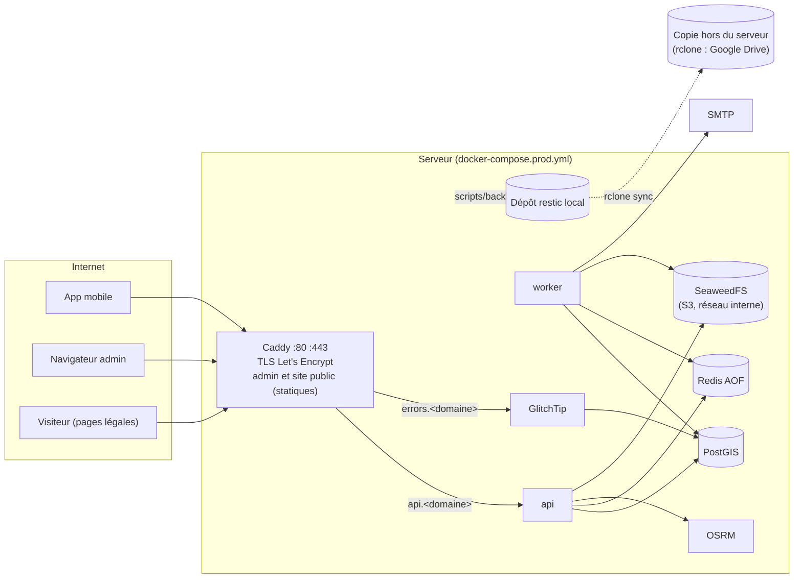

# Déploiement — runbook

> Indépendant du fournisseur : un VPS Ubuntu, un domaine, un SMTP et un espace de stockage hors du serveur pour la copie des sauvegardes (Google Drive par rclone, ou tout remote rclone). Tout le reste tourne dans `docker-compose.prod.yml` (stockage objet SeaweedFS compris) et se pilote par `scripts/prod.sh`. Répété en local le 2026-10-21 (§13), puis déployé en staging sur un VPS Wayhost le 2026-10-22 (§17). Fichiers : `docker-compose.prod.yml`, `deploy/` (Caddyfile, image du proxy, init de PostgreSQL, configuration de GlitchTip, outils du staging), `.env.production.example`, `scripts/{gen-prod-secrets,prod,backup,restore,staging,gdrive-authorize}.sh`.

**Sommaire** : 1. Vue d'ensemble · 2. Prérequis · 3. Serveur · 4. Pare-feu · 5. Docker · 6. DNS et email · 7. Stockage des fichiers · 8. Premier déploiement · 9. Mise à jour · 10. Sauvegarde · 11. Restauration · 12. Retour arrière · 13. Répéter en local · 14. Secrets · 15. Supervision · 16. Dépannage · 17. Staging (VPS Wayhost)

## 1. Vue d'ensemble



| Site | Contenu |
|---|---|
| `https://<domaine>` | Site public : politique de confidentialité, CGU, **suppression de compte** (`/suppression-compte`, lien pour Google Play) |
| `https://api.<domaine>` | API (en-têtes de sécurité posés par l'API) |
| `https://admin.<domaine>` | Admin web (build statique, CSP stricte de `Web/dist/csp.txt`) |
| `https://errors.<domaine>` | GlitchTip (rapports de plantage, D90) ; l'IP des clients ne lui parvient pas |

Seul Caddy publie des ports. PostgreSQL, Redis, OSRM, l'API, le worker et GlitchTip ne sont joignables que sur le réseau Docker interne (`172.31.0.0/24`, Caddy en `172.31.0.10`, seule adresse dont l'API accepte `X-Forwarded-For`). SeaweedFS est sur un second réseau interne (`storage`) que seuls l'API et le worker rejoignent.

## 2. Prérequis

| Élément | Exigence |
|---|---|
| VPS | Ubuntu Server LTS (26.04 ou 24.04), **2 vCPU, 4 Go de RAM** (8 Go confortables), 40 Go SSD, IPv4 publique (IPv6 bienvenue). Au repos, les 9 services occupent ~700 Mo ; les builds (Go, Vite) montent à ~2,5 Go. Localisation : à arbitrer avec le juriste (APDP, transferts hors du Bénin, D4) |
| Domaine | Un domaine dont vous gérez la zone DNS (5 enregistrements, §6) |
| SMTP | Un service d'envoi transactionnel avec STARTTLS ou TLS (port 587 ou 465), un domaine d'envoi vérifié (SPF, DKIM, DMARC), identifiants SMTP |
| Stockage des fichiers | Rien à fournir : SeaweedFS (compatible S3) tourne dans le compose. Un fournisseur S3 externe reste possible (§7) |
| Copie des sauvegardes | Un remote rclone hors du serveur : Google Drive (accès `drive.file`, `scripts/gdrive-authorize.sh`) ou un bucket chez un autre fournisseur |
| Expo | `EXPO_ACCESS_TOKEN` (déjà dans le `.env` de dev), accès au projet EAS `@hen_ry/gostation` |
| Poste d'exploitation | Un coffre de mots de passe pour `DOCUMENTS_ENCRYPTION_KEY`, `RESTIC_PASSWORD` et les accès au remote rclone ; `rclone` (autorisation Google Drive) |

## 3. Serveur

Connecté en root la première fois (ou avec l'utilisateur fourni par l'hébergeur) :

```bash
timedatectl set-timezone UTC                      # horodatages en UTC ; l'app gère Africa/Porto-Novo
apt update && apt full-upgrade -y
apt install -y git ufw fail2ban unattended-upgrades python3 openssl
dpkg-reconfigure -plow unattended-upgrades        # mises à jour de sécurité automatiques
# Redémarrage automatique à 04:00 UTC si une mise à jour du noyau l'exige
printf 'Unattended-Upgrade::Automatic-Reboot "true";\nUnattended-Upgrade::Automatic-Reboot-Time "04:00";\n' > /etc/apt/apt.conf.d/52gostation
adduser --disabled-password --gecos "" deploy
mkdir -p /home/deploy/.ssh && cp ~/.ssh/authorized_keys /home/deploy/.ssh/ && chown -R deploy: /home/deploy/.ssh
# SSH : clés seulement, pas de root. sshd garde la première valeur lue : « 00- » passe avant le
# 50-cloud-init.conf des images cloud, qui remet PasswordAuthentication yes.
cat > /etc/ssh/sshd_config.d/00-gostation.conf <<'CONF'
PasswordAuthentication no
KbdInteractiveAuthentication no
PermitRootLogin no
PubkeyAuthentication yes
X11Forwarding no
MaxAuthTries 3
CONF
sshd -t && systemctl reload ssh
# fail2ban sur SSH (nftables, journal systemd)
printf '[DEFAULT]\nbanaction = nftables\nbanaction_allports = nftables[type=allports]\nbackend = systemd\n[sshd]\nenabled = true\n' > /etc/fail2ban/jail.d/gostation.conf
systemctl restart fail2ban
# Swap : 2 Go minimum, 4 Go sur un serveur de 8 Go (marge pour les builds Node et Go)
fallocate -l 4G /swapfile && chmod 600 /swapfile && mkswap /swapfile && swapon /swapfile
echo '/swapfile none swap sw 0 0' >> /etc/fstab
```

Vérifier qu'une nouvelle session `ssh deploy@<ip>` fonctionne, et que `ssh -o PubkeyAuthentication=no deploy@<ip>` est refusée, avant de fermer la session root. Avec `MaxAuthTries 3`, un client qui propose d'abord d'autres clés est coupé : sur le poste, une entrée `Host` avec `IdentityFile` et `IdentitiesOnly yes` (§17).

## 4. Pare-feu

```bash
ufw default deny incoming && ufw default allow outgoing
ufw allow OpenSSH
ufw allow 80/tcp && ufw allow 443/tcp && ufw allow 443/udp   # HTTP (ACME, redirection), HTTPS, HTTP/3
ufw enable && ufw status verbose
```

Docker écrit ses propres règles iptables pour les ports publiés : ufw ne les filtre pas. C'est sans risque ici, seul Caddy publie des ports (80 et 443). Ne jamais ajouter de `ports:` à un autre service de `docker-compose.prod.yml`.

## 5. Docker

Dépôt officiel Docker (Engine et plugin Compose v2) :

```bash
install -m 0755 -d /etc/apt/keyrings
curl -fsSL https://download.docker.com/linux/ubuntu/gpg -o /etc/apt/keyrings/docker.asc
echo "deb [arch=$(dpkg --print-architecture) signed-by=/etc/apt/keyrings/docker.asc] https://download.docker.com/linux/ubuntu $(. /etc/os-release && echo "$VERSION_CODENAME") stable" > /etc/apt/sources.list.d/docker.list
apt update && apt install -y docker-ce docker-ce-cli containerd.io docker-buildx-plugin docker-compose-plugin
usermod -aG docker deploy
docker compose version    # v2.24 ou plus (balises !override de la répétition)
```

## 6. DNS et email

Avant le premier déploiement (Let's Encrypt valide chaque nom par HTTP) :

| Nom | Type | Valeur |
|---|---|---|
| `<domaine>` | A (et AAAA) | IP du serveur |
| `www.<domaine>` | A (et AAAA) | IP du serveur (redirigé vers `<domaine>`) |
| `api.<domaine>` | A (et AAAA) | IP du serveur |
| `admin.<domaine>` | A (et AAAA) | IP du serveur |
| `errors.<domaine>` | A (et AAAA) | IP du serveur |

Email (chez le fournisseur SMTP, pour le domaine de `SMTP_FROM`) : SPF (`TXT v=spf1 include:<fournisseur> -all`), DKIM (clé fournie), DMARC (`_dmarc TXT v=DMARC1; p=quarantine; rua=mailto:…`). Contrôle : `dig +short TXT <domaine>`, puis un email de test depuis l'app (vérification d'adresse) arrivé hors spam.

`admin.<domaine>` et `api.<domaine>` doivent rester sous le même domaine : les cookies `SameSite=Strict` de l'admin en dépendent (D43).

## 7. Stockage des fichiers

Par défaut, **SeaweedFS** (service `s3` du compose, compatible S3, image figée par `SEAWEEDFS_IMAGE`) : bucket `S3_BUCKET` créé au démarrage, clés `S3_ACCESS_KEY_ID` / `S3_SECRET_ACCESS_KEY` générées par `scripts/gen-prod-secrets.sh`, aucun accès anonyme, interface d'administration et WebDAV coupés, sur le réseau interne `storage` (API, worker et sauvegardes seulement). Il ne reçoit que des fichiers déjà chiffrés par l'application (enveloppe AES-256-GCM) ; `scripts/backup.sh` en garde un miroir dans chaque sauvegarde. Valeurs de `.env.production.example` : `S3_ENDPOINT=s3:8333`, `S3_TLS=false`, `S3_PATH_STYLE=true`.

**Fournisseur S3 externe** (option) : créer un bucket privé (sans site web ni accès public) et une clé limitée à ce bucket (lecture, écriture, suppression), puis renseigner `S3_ENDPOINT` (hôte sans `https://`), `S3_REGION`, `S3_BUCKET`, les clés, `S3_TLS=true` et `S3_PATH_STYLE` selon le fournisseur.

## 8. Premier déploiement

En tant que `deploy` :

```bash
sudo mkdir -p /srv/gostation /var/lib/gostation-backup && sudo chown deploy: /srv/gostation /var/lib/gostation-backup
git clone https://github.com/Hen17Ry/gostation.git /srv/gostation && cd /srv/gostation
scripts/gen-prod-secrets.sh          # .env.production (600), secrets aléatoires
nano .env.production                 # remplacer chaque fill-me (domaine, SMTP, S3, Expo, contact)
scripts/prod.sh check                # refuse tant qu'il reste un fill-me ou un change-me
```

Copier tout de suite dans le coffre de mots de passe : `DOCUMENTS_ENCRYPTION_KEY` (sans elle, les justificatifs sont perdus), `RESTIC_PASSWORD` (sans lui, les sauvegardes sont illisibles), `APP_SECRET`, les clés S3. Une variable ajoutée au modèle après la création du fichier : `scripts/gen-prod-secrets.sh --sync .env.production` (secret généré, rien d'autre modifié).

```bash
scripts/prod.sh osrm-prepare         # extrait Bénin (~50 Mo) et graphe OSRM (~1 min)
scripts/prod.sh deploy               # build api + proxy, migrations, démarrage, attente des healthchecks (~5 min sur 2 vCPU)
scripts/prod.sh admin-create ada@<domaine> Ada Admin   # mot de passe saisi au clavier, 2FA au premier login
```

Contrôles :

```bash
curl -s https://api.<domaine>/readyz                  # {"status":"ready",…}
curl -sI https://admin.<domaine>/ | grep -i content-security-policy
curl -sI https://<domaine>/suppression-compte | head -1
scripts/prod.sh ps                                    # tout healthy
```

Puis se connecter à `https://admin.<domaine>` (configuration de la 2FA, 10 codes de secours à garder).

**GlitchTip** (suivi des plantages, D90) :

```bash
scripts/prod.sh glitchtip-setup      # compte GLITCHTIP_ADMIN_*, organisation, équipe, projets api, admin et mobile
```

Le script (`deploy/glitchtip-setup.py`, idempotent) n'affiche que les trois DSN (`SENTRY_DSN`, `VITE_SENTRY_DSN`, `MOBILE_SENTRY_DSN`) ; les reporter dans `.env.production` (depuis le poste, pour le staging : `scripts/staging.sh glitchtip-setup` les écrit directement dans `deploy/staging.env`), puis `scripts/prod.sh deploy` (`VITE_SENTRY_DSN` est figé dans le build de l'admin et ajouté à sa CSP). L'IP des clients est anonymisée dans chaque projet ; GlitchTip n'accepte que son nom public (`ALLOWED_HOSTS`). Au tout premier démarrage, GlitchTip crée son schéma : `errors.<domaine>` répond 502 pendant une à deux minutes. Contrôle : `scripts/prod.sh errtrack-test` (un événement de l'API et un du worker) ; l'admin et l'app envoient leurs plantages directement.

**App mobile** : variables EAS de l'environnement `production` (et `preview` pour le staging), puis un nouveau build :

```bash
cd Mobile
eas env:create --environment production --name EXPO_PUBLIC_API_URL --value https://api.<domaine> --visibility plaintext
eas env:create --environment production --name EXPO_PUBLIC_SENTRY_DSN --value <DSN du projet mobile> --visibility plaintext
EXPO_NO_DOTENV=1 eas build --profile production --platform android
```

**Google Play** : URL de la politique `https://<domaine>/politique-confidentialite`, URL de suppression de compte `https://<domaine>/suppression-compte`.

**Base déjà initialisée** (PostgreSQL créé avant l'ajout de GlitchTip) : le script `deploy/postgres/init/20-glitchtip.sh` ne s'exécute que sur une base vide. Le jouer à la main une fois :

```bash
docker compose -p gostation-prod exec -T postgres bash /docker-entrypoint-initdb.d/20-glitchtip.sh
```

## 9. Mise à jour

```bash
cd /srv/gostation && git pull
scripts/prod.sh deploy
```

`deploy` met à jour les images tierces épinglées, reconstruit l'API et le proxy (étiquetés par `git describe`), applique les migrations puis recrée les services modifiés. L'API est indisponible quelques secondes pendant son remplacement (Caddy répond 502). Après un changement de `.env.example` côté backend, reporter la variable dans `.env.production` (même nom) avant le déploiement.

Images Docker : `docker image prune` de temps en temps, en gardant les deux ou trois dernières versions de `gostation-api` et `gostation-proxy` (retour arrière).

## 10. Sauvegarde

Quotidienne, par cron (utilisateur `deploy`), à 2 h 30 (les purges de conservation tournent à 3 h, heure du Bénin) :

```bash
crontab -e
30 1 * * * cd /srv/gostation && scripts/prod.sh backup >> /var/lib/gostation-backup/backup.log 2>&1
```

Copie hors du serveur (`BACKUP_RCLONE_REMOTE`, par exemple `gdrive:gostation-backups/production`) : sur le poste qui a un navigateur, `scripts/gdrive-authorize.sh deploy/<env>.rclone.conf` (accès `drive.file` : rclone ne voit que le dossier qu'il crée), puis `scripts/prod.sh backup-remote-setup < deploy/<env>.rclone.conf` sur le serveur (jamais collé au clavier). Contrôle : `scripts/backup.sh remote` (taille de la copie). **Client OAuth Google personnel** (celui de rclone est retiré par Google en 2026) : projet Google Cloud, API Google Drive activée, écran de consentement « Externe » avec la seule autorisation `drive.file`, **application publiée** (« En production » : en statut « Test », Google fait expirer l'autorisation au bout de 7 jours ; `drive.file` ne demande pas de validation), client « Application de bureau ». Ses identifiants vont dans `deploy/gdrive-client.env` (`GDRIVE_CLIENT_ID`, `GDRIVE_CLIENT_SECRET`, 600, gitignoré, jamais affichés), que `scripts/gdrive-authorize.sh` lit. Avec `drive.file`, un client ne voit que ce qu'il a créé : en changeant de client, renommer d'abord l'ancien dossier `gostation-backups`, puis le supprimer une fois la nouvelle copie vérifiée.

(1 h 30 UTC = 2 h 30 à Porto-Novo.) Chaque passage :

1. `pg_dump -Fc` de la base GoStation ;
2. les fichiers : miroir incrémental du bucket (rclone) ou volume local ;
3. `.env.production` (nécessaire pour relire les fichiers) ;
4. `restic backup` vers `RESTIC_REPOSITORY` (dépôt local du serveur, chiffré, dédupliqué), puis `restic forget --prune` : **7 quotidiennes, 4 hebdomadaires, 3 mensuelles** (une donnée purgée disparaît des sauvegardes 3 mois au plus après, durée indiquée dans la politique ; sur Google Drive, 30 jours de corbeille en plus) ;
5. `restic check` sur un septième des données (tout le dépôt chaque semaine) ;
6. `rclone sync` du dépôt vers `BACKUP_RCLONE_REMOTE` (déjà chiffré par restic).

Non sauvegardés : Redis (sessions, files, quotas, cache : après une restauration, tout le monde se reconnecte), GlitchTip, certificats. Lister les sauvegardes : `scripts/prod.sh snapshots`. Surveiller `backup.log` (ou ajouter un ping vers un service de surveillance de tâches cron en fin de commande).

## 11. Restauration

**Sur le même serveur** (base corrompue, erreur humaine) :

```bash
scripts/prod.sh snapshots                 # choisir l'identifiant, ou « latest »
scripts/prod.sh restore <snapshot>        # confirmation à taper ; --yes pour un script
```

Le script arrête l'API et le worker, recrée la base et y restaure le dump, remet les fichiers (bucket synchronisé : les objets créés après la sauvegarde sont supprimés), vide Redis, rejoue les migrations, redémarre et affiche le nombre de comptes et de stations.

**Sur un nouveau serveur** (perte du serveur) : §3 à §6, puis

```bash
git clone https://github.com/Hen17Ry/gostation.git /srv/gostation && cd /srv/gostation
# .env.production minimal, depuis le coffre : RESTIC_REPOSITORY (chemin local), RESTIC_PASSWORD,
# BACKUP_RCLONE_REMOTE (chmod 600) ; puis le rclone.conf du poste (§10)
scripts/prod.sh backup-remote-setup < rclone.conf
scripts/backup.sh pull                    # rapatrie la copie hors du serveur dans le dépôt local
scripts/prod.sh restore env latest        # récupère le .env.production sauvegardé
mv .env.production.restored .env.production
scripts/prod.sh osrm-prepare && scripts/prod.sh deploy
scripts/prod.sh restore latest --yes
```

Mettre à jour le DNS si l'IP a changé. Les sessions et les files d'attente repartent de zéro.

## 12. Retour arrière

```bash
scripts/prod.sh versions                  # versions construites sur ce serveur
scripts/prod.sh rollback <version>        # api, worker et proxy sur les images de cette version
```

La version en service est la dernière ligne de `var/releases` (écrite par `deploy` et `rollback`) : toutes les autres commandes (`restore`, `migrate`, `admin-create`, `errtrack-test`) reprennent cette version, jamais une image `latest`. Staging, depuis le poste : `make rollback-staging v=<version>` (§17).

Les migrations ne sont jamais annulées automatiquement. Règle de développement : une migration doit rester compatible avec la version précédente du code (ajouter avant d'utiliser, supprimer une version plus tard). Si une version a modifié le schéma de façon incompatible : restaurer la sauvegarde prise avant le déploiement (§11) ; en lancer une juste avant tout déploiement risqué (`scripts/prod.sh backup`).

## 13. Répéter en local

Toute la chaîne (build, migrations, TLS, GlitchTip, stockage S3, sauvegarde, restauration) se rejoue sur un poste avec Docker, sans domaine : `DOMAIN=gostation.localhost` (Caddy signe lui-même les certificats des noms `*.localhost`), SeaweedFS sert de stockage objet et de dépôt restic, Mailpit reçoit les emails (`deploy/rehearsal.compose.yml`, ports liés à 127.0.0.1).

```bash
scripts/gen-prod-secrets.sh .env.rehearsal
# DOMAIN=gostation.localhost, APP_ENV=staging, S3_ENDPOINT=s3:8333, S3_TLS=false, S3_PATH_STYLE=true,
# S3_BUCKET=gostation, clés rehearsal / rehearsal-secret, SMTP_HOST=mailpit SMTP_PORT=1025 SMTP_TLS=none,
# RESTIC_REPOSITORY=s3:http://s3:8333/gostation-backups, GLITCHTIP_EMAIL_URL=smtp://mailpit:1025
export GOSTATION_ENV_FILE=$PWD/.env.rehearsal GOSTATION_EXTRA_COMPOSE=deploy/rehearsal.compose.yml
export BACKUP_WORK_DIR=$PWD/var/backup-work      # sans droits root sur /var/lib
scripts/prod.sh check && scripts/prod.sh osrm-prepare && scripts/prod.sh deploy
curl -sk https://api.gostation.localhost/readyz
scripts/prod.sh backup && scripts/prod.sh restore latest --yes
docker compose -p gostation-prod down -v   # tout supprimer ensuite (données de test comprises)
```

Répétition du 2026-10-21 : 9 services sains, seul Caddy publie des ports ; en-têtes vérifiés sur chaque site ; inscription d'un gérant avec justificatif à travers le proxy (fichier chiffré dans le bucket, email reçu) ; admin créé par `scripts/prod.sh admin-create` ; sauvegarde, destruction de la base et du fichier, restauration : comptes, station et objet revenus (même somme de contrôle), justificatif relu par l'admin et déchiffré à l'identique ; un événement envoyé à GlitchTip avec des en-têtes `X-Forwarded-For` et `X-Real-IP` falsifiés n'a conservé aucune adresse. Elle a corrigé trois défauts avant tout serveur réel : le script d'init masquait celui de PostGIS, `APP_ENV` était imposé à `production`, et le journal d'erreurs de Caddy contenait l'IP et l'URL des clients.

## 14. Secrets

| Secret | Rotation |
|---|---|
| `JWT_SIGNING_KEYS` | Ajouter une nouvelle clé **en tête** (`kNEW:hex,kOLD:hex`), déployer, retirer l'ancienne 15 min plus tard |
| `RATE_LIMIT_KEY` | Remplacer et redéployer : seuls les compteurs (1 h au plus) repartent de zéro |
| `REDIS_PASSWORD`, `POSTGRES_PASSWORD`, `GLITCHTIP_DB_PASSWORD` | Changer dans le service (`ALTER ROLE … PASSWORD`, puis `.env.production`), redéployer |
| `APP_SECRET` | À éviter : invalide les codes en cours, le CSRF des sessions admin et **déchiffre les secrets TOTP** (2FA à reconfigurer pour chaque admin) |
| `DOCUMENTS_ENCRYPTION_KEY` | Jamais sans procédure de rechiffrement : les fichiers existants deviendraient illisibles |
| `RESTIC_PASSWORD` | `restic key add` puis `restic key remove` (le dépôt reste lisible) |
| Clés S3, SMTP, `EXPO_ACCESS_TOKEN` | Créer la nouvelle chez le fournisseur, mettre à jour `.env.production`, redéployer, révoquer l'ancienne |

`.env.production` reste en 600, appartient à `deploy`, n'est jamais copié ailleurs qu'au coffre et dans les sauvegardes chiffrées.

## 15. Supervision

- `scripts/prod.sh ps` (healthchecks), `scripts/prod.sh logs api` (journaux JSON sans IP, position ni email, rotation 3 × 10 Mo par service).
- GlitchTip : erreurs 5xx, panics, tâches en échec définitif, plantages de l'admin et de l'app (alertes par email à configurer dans chaque projet).
- Espace disque : `df -h /var/lib/docker` (PostgreSQL, OSRM, images).
- Externe : `.github/workflows/monitor.yml` contrôle `/readyz` et l'expiration du certificat toutes les 30 min (trois essais avant l'alerte) ; en cas d'échec, une issue `monitoring` est ouverte, commentée tant que la panne dure, puis fermée au premier contrôle réussi. URL surchargeable par la variable de dépôt `MONITOR_READYZ_URL`. Toutes les 30 et non 15 min : chaque exécution compte pour au moins une minute d'Actions (~1 440 min/mois sur un quota gratuit de 2 000 pour un dépôt privé). GitHub ne lance les tâches planifiées que depuis la branche par défaut, parfois avec du retard.

## 16. Dépannage

| Symptôme | Piste |
|---|---|
| Certificat non émis | DNS pas encore propagé (`dig +short api.<domaine>`), port 80 bloqué ; `scripts/prod.sh logs caddy` |
| `api` jamais healthy | `scripts/prod.sh logs api` : configuration refusée au démarrage (message par variable) ou base injoignable |
| `/readyz` : `osrm: fail` | Données OSRM absentes : `scripts/prod.sh osrm-prepare` ; la recherche continue à vol d'oiseau |
| Emails non reçus | `scripts/prod.sh logs worker` (code SMTP), SPF/DKIM, `SMTP_TLS` |
| Fichiers illisibles après une restauration | `DOCUMENTS_ENCRYPTION_KEY` différente de celle de la sauvegarde : reprendre celle du `.env.production` sauvegardé |
| GlitchTip ne reçoit rien | DSN vide ou erroné ; `errors.<domaine>` résolu ; pour l'admin, origine du DSN absente de la CSP (rebuild après avoir renseigné `VITE_SENTRY_DSN`) |
| `ssh` expire juste après quelques commandes | Filtrage de l'hébergeur en amont (Wayhost : le port 22 se ferme quelques minutes à une IP qui ouvre des connexions en rafale). Une connexion maître (`scripts/staging.sh` la garde 10 min) ; attendre ~5 min ; `sudo fail2ban-client status sshd` pour écarter fail2ban |
| `ssh` coupé avant le mot de passe de la clé | `MaxAuthTries 3` : le client propose d'autres clés d'abord ; `IdentitiesOnly yes` dans `~/.ssh/config` |
| Ports 80 et 443 injoignables de l'extérieur, joignables sur le serveur | Pare-feu du panneau de l'hébergeur (en plus d'ufw) : ouvrir TCP 80, TCP 443 et UDP 443, en IPv4 et IPv6 |
| Un nom introuvable pour certains (« unknown host », NXDOMAIN), pas pour d'autres | Zone DNS incohérente : `make check-dns` liste les serveurs qui répondent faux ; un résolveur garde la réponse négative jusqu'à une heure (minimum du SOA) |
| Note mail-tester basse | Texte invisible dans un gabarit (test `TestEmailsHaveNoHiddenText`) ; pixels de suivi du fournisseur SMTP (à désactiver) |

## 17. Staging (VPS Wayhost)

Mis en place le 2026-10-22 ; piloté depuis le poste d'exploitation par `scripts/staging.sh` et les cibles `make *-staging`. Jamais de données réelles : stations fictives, comptes de test supprimés après chaque campagne.

| Élément | Valeur |
|---|---|
| Serveur | VPS Wayhost, Ubuntu 24.04, 2 vCPU, 8 Go de RAM, 97 Go, swap 4 Go ; `45.93.21.86` et `2a12:a080:1:1::10b2` ; utilisateurs `ubuntu` (sudo) et `deploy` (Docker, `/srv/gostation`) |
| Sites | `https://gostation.bj` (public, en noindex hors production), `https://api.gostation.bj`, `https://admin.gostation.bj`, `https://errors.gostation.bj` |
| `www` | Servi et redirigé (301) vers `gostation.bj` depuis le 2026-10-22 (`PUBLIC_EXTRA_HOSTS=www.gostation.bj`, procédure « Ajouter www » ci-dessous) |
| Configuration | `deploy/staging.env` sur le poste (600, gitignoré), copié en `.env.production` à chaque déploiement (`env-push` liste les clés modifiées, jamais les valeurs) ; `APP_ENV=staging`, `GOSTATION_EXTRA_COMPOSE=deploy/staging.compose.yml` |
| Identification | Bandeau « Staging » dans l'admin (liseré, badge, titre d'onglet) et dans l'app (`EXPO_PUBLIC_APP_ENV=staging`), `X-Robots-Tag: noindex` et `robots.txt` fermé sur le site public, stations nommées « Station démo NNNN – ville », marques « … Démo », « Adresse fictive » |
| Emails | Brevo (`smtp-relay.brevo.com:587`, expéditeur `noreply@gostation.bj`, SPF, DKIM et DMARC) ; les adresses de test (`example.bj`, `*.test`) partent vers le Mailpit du serveur (`SMTP_SINK_*`), jamais chez Brevo |
| Fichiers | SeaweedFS (§7) |
| Sauvegardes | Dépôt restic local `/var/lib/gostation-backup/restic`, copié vers `gdrive:gostation-backups/staging` (Google Drive, accès `drive.file`) |
| Suivi des plantages | GlitchTip, organisation GoStation, projets `api`, `admin`, `mobile`, environnement `staging` |
| App | Variables EAS de `preview` : `EXPO_PUBLIC_API_URL=https://api.gostation.bj`, `EXPO_PUBLIC_APP_ENV=staging`, `EXPO_PUBLIC_SENTRY_DSN` (projet mobile), `EXPO_PUBLIC_SENTRY_ENVIRONMENT=staging`. `production` pointe aussi sur `https://api.gostation.bj` en attendant un serveur de production |

### Spécificités de Wayhost

- **Pare-feu du panneau**, en amont d'ufw : 80 et 443 y sont fermés par défaut. Ouvrir TCP 80, TCP 443 et UDP 443 (HTTP/3), en IPv4 et IPv6. Symptôme : les ports répondent sur le serveur, la connexion expire depuis l'extérieur.
- **Limite de connexions SSH**, en amont aussi : après 4 ou 5 connexions ouvertes en peu de temps, le port 22 ne répond plus pendant ~5 min (ni ufw ni fail2ban n'y sont pour rien). `scripts/staging.sh` garde une connexion maître 10 min (`ControlPersist`), que toutes ses commandes réutilisent ; pour une longue session : `ssh -fNM -o ControlPath="$HOME/.ssh/cm-gostation-%r@%h:%p" -o ControlPersist=6h deploy@45.93.21.86`.
- **Image cloud-init** : `PasswordAuthentication yes` dans `50-cloud-init.conf`, d'où le fichier `00-gostation.conf` (§3).
- **DNS** : déplacé le 2026-10-22 de Wayhost vers **Cloudflare** (`dave.ns.cloudflare.com`, `fay.ns.cloudflare.com`), toutes les entrées en **« DNS uniquement »** (jamais « Proxied » : Cloudflare verrait tout le trafic et Caddy n'accepte `X-Forwarded-For` que de lui-même). La zone Wayhost était incohérente : la délégation du `.bj` et les NS de la zone différaient, et `ns1.netim.net` servait une ancienne version sans `api`, `admin` ni `errors` ; les résolveurs qui l'interrogeaient ne trouvaient plus ces noms (le téléphone de test n'envoyait plus ses rapports de plantage). 14 entrées : A et AAAA de `@`, `www`, `api`, `admin`, `errors` ; SPF (`v=spf1 include:spf.brevo.com ~all`), DMARC (`_dmarc`), DKIM de Brevo (`brevo1._domainkey`, `brevo2._domainkey` en CNAME). Contrôle : `make check-dns` (aussi dans la surveillance). Après un changement de serveurs, les résolveurs gardent l'ancienne réponse négative jusqu'à une heure.

### Ajouter www

Seulement une fois le DNS corrigé : Caddy demande le certificat au redémarrage, et Let's Encrypt bloque un nom pendant une heure après 5 validations échouées.

```bash
dig +short www.gostation.bj A       # doit donner 45.93.21.86
dig +short www.gostation.bj AAAA    # doit donner 2a12:a080:1:1::10b2 (ou rien, sans enregistrement AAAA)
sed -i 's/^PUBLIC_EXTRA_HOSTS=.*/PUBLIC_EXTRA_HOSTS=www.gostation.bj/' deploy/staging.env
make deploy-staging                 # env poussé, Caddy redémarré : certificat de www émis
curl -sI https://www.gostation.bj/suppression-compte | grep -iE '^HTTP|^location'   # 301 vers https://gostation.bj/suppression-compte
```

### Poste d'exploitation

```
# ~/.ssh/config : sans IdentitiesOnly, d'autres clés passent avant et MaxAuthTries 3 coupe la connexion
Host gostation-staging 45.93.21.86
  HostName 45.93.21.86
  IdentityFile ~/.ssh/id_ed25519
  IdentitiesOnly yes
```

Le serveur récupère le code avec une clé de déploiement GitHub en lecture seule (`~deploy/.ssh/github_deploy`, empreinte de github.com vérifiée).

### Mise en place (rejouable)

```bash
scripts/gen-prod-secrets.sh deploy/staging.env      # poste : secrets générés, 600
# remplir DOMAIN, ACME_EMAIL, APP_ENV=staging, GOSTATION_EXTRA_COMPOSE, SMTP_* (SMTP_PASSWORD collé
# par l'exploitant), SMTP_SINK_ADDR=mailpit:1025, SMTP_SINK_DOMAINS=example.bj,test,
# BACKUP_RCLONE_REMOTE=gdrive:gostation-backups/staging, GLITCHTIP_ADMIN_EMAIL
scripts/gdrive-authorize.sh                         # deploy/staging.rclone.conf (navigateur)
# serveur : §3 à §5, clé de déploiement, git clone dans /srv/gostation
scripts/staging.sh env-push && scripts/staging.sh prod check
scripts/staging.sh prod osrm-prepare
scripts/staging.sh backup-remote-setup
make deploy-staging REF=origin/main
scripts/staging.sh prod seed                        # 5 000 stations fictives, 30 jours de stats
scripts/staging.sh glitchtip-setup                  # DSN écrits dans deploy/staging.env
make deploy-staging REF=origin/main                 # API, worker et admin avec leurs DSN
scripts/staging.sh prod errtrack-test
scripts/staging.sh prod admin-create <email> <prénom> <nom>   # terminal interactif : mot de passe au clavier
```

Crontab de `deploy` :

```
30 1 * * * cd /srv/gostation && scripts/prod.sh backup >> /var/lib/gostation-backup/backup.log 2>&1
15 */4 * * * cd /srv/gostation && scripts/prod.sh seed -refresh >> /srv/gostation/var/seed-refresh.log 2>&1
```

Le second redonne des âges réalistes aux stocks fictifs : sans lui, ils sortent de la recherche au bout de 24 h.

### Mise à jour et retour arrière

```bash
make deploy-staging                   # REF=origin/main par défaut ; REF=origin/<branche> pour essayer une branche
scripts/staging.sh prod versions      # versions construites
make rollback-staging v=<version>     # api, worker et proxy sur une version déjà construite
```

`deploy-staging` pousse `deploy/staging.env`, place le serveur sur `REF`, puis lance `scripts/prod.sh deploy` **détaché de la session SSH** (journal `var/deploy-<date>.log` sur le serveur, suivi depuis le poste) : une coupure réseau n'interrompt ni le build ni les migrations. Les migrations ne sont jamais annulées (§12) : avant un déploiement risqué, `scripts/staging.sh prod backup`.

### Tests contre le staging

| Commande | Ce qui se passe |
|---|---|
| `cd Web && npm run e2e:staging` | Scénarios Playwright de l'admin contre `https://admin.gostation.bj` (TLS, CSP et en-têtes réels). Fixtures et admins de test créés par SSH, puis supprimés avec leurs données (`e2e-cleanup`) |
| `cd Mobile && npm run e2e:staging` | Parcours Maestro sur le téléphone branché (build `preview`) : tunnel SSH vers Mailpit et le pilotage (`e2e-control`), recherche, itinéraire, inscription, gérant et stocks, push réel ; comptes de test supprimés à la fin |
| `make staging-tunnel` | Mailpit (`127.0.0.1:18025`) et pilotage des parcours (`127.0.0.1:18097`), jamais exposés sur Internet |

### Avant la production

- **DNS** : chez Cloudflare, cohérent (`make check-dns`) ; la production aura sa propre zone ou ses propres noms.
- **Brevo** : le pixel d'ouverture ne se coupe ni par SMTP ni par l'API (suivi anonyme seulement) : obtenir sa désactivation du support, ou changer de fournisseur (inventaire, écart E9).
- **rclone** : `client_id` Google propre (§10).
- **Diagnostic du suivi des plantages de l'app** : une build `preview` avec la variable EAS `EXPO_PUBLIC_SENTRY_DEBUG=1` affiche les journaux du SDK dans `adb logcat` et envoie un message de test au démarrage ; la retirer ensuite. Plantage de test : Compte › Staging.
- Un serveur et un `.env.production` distincts du staging ; l'environnement EAS `production` repointé vers l'API de production.
